# System Design: Capacity, Service Levels and Low-Level Design (LLD)

> Status: draft for engineer review. The architecture overview is in the [HLD](03-architecture.md);
> decisions and their rationale are in [`adr/`](adr/README.md).

## Glossary

| Term | Meaning |
|---|---|
| **Cloud (deployment) region** | One physical cloud location where a complete copy of the system runs with its own database, e.g. Azure `eastus` or AWS `eu-west-1`. **Not** a business geography (NA, EMEA, APAC): one geography can be served by several cloud regions. v1 uses exactly one. |
| **Availability zone (AZ)** | A separate data center **inside** a cloud region. v1 spreads instances and database nodes across AZs for high availability. AZs share their region's database and ID blocks. |
| **Region index** | The small integer that identifies a deployment region in the block registry (`ShortCode:DeploymentRegionIndex`, v1 = 0) |
| **Region block** | A contiguous range of IDs owned by one region, assigned by an operator (§6.4) |
| **Lease** | A batch of 10,000 IDs that an Api instance takes from its region's block and hands out from memory |
| **Primary / standby / read replica** | PostgreSQL roles: the primary accepts writes; the synchronous standby takes over on failure; read replicas serve redirects (ADR-0002, ADR-0004) |

## 1. Capacity estimates

Target: **100M new URLs/day** and a **10:1 read:write ratio** (A-10, A-11), in a single region (A-17).

| Metric | Calculation | Result |
|---|---|---|
| Write QPS, average / peak (×3) | 100M ÷ 86,400 s | **~1,160 / ~3,500** |
| Read QPS, average / peak (×3) | 1B ÷ 86,400 s | **~11,600 / ~35,000** |
| Record size | code, URL, metadata, index overhead | ~500 B (conservative) |
| Links storage | 100M × 500 B = 50 GB/day | **~18 TB/year, ~91 TB over 5 years** |
| Key space | 62⁷ ≈ 3.5T vs 182.5B needed | ~96 years of headroom at 7 chars; **v1 block B-001 alone covers ~12 years** |
| Random-guess hit rate | Share of the code space in use | ~1% after 1 year, ~5% after 5 years (NFR-09). Rate limiting is the mitigation. |
| Click events | 1B × ~200 B (JSON) | ~200 GB/day in Kafka; 30-day retention ≈ 6 TB (× replication factor) |
| Rollup writes | One upsert per (code, hour, dimension) per worker batch | Far fewer than clicks, thanks to per-batch aggregation |
| Bandwidth | 1,160 × 500 B in; 11,600 × 500 B out | ~0.6 MB/s in; ~6 MB/s out (~17 MB/s at peak) |
| ID-lease load | 3,500/s ÷ 10K per lease | ~0.35 lease updates/s |

**What this means for the design:**
- A single PostgreSQL primary handles the write rate easily (~3.5K/s).
- Reads are spread across read replicas. At ~5–10K point reads/s per replica, that's about **4–8 replicas at peak** (to be confirmed by the load test).
- Storage fits on one node for **~1.5–2 years**. Citus is added when the ADR-0004 thresholds are reached.
- A laptop can't reproduce 35K/s, so cluster size is **extrapolated from measured per-node throughput and p99**.

## 2. Service levels (SLO / SLA)

Measured monthly, server-side, within one region (A-19).
**SLO** = internal target. **SLA** = external commitment, set looser than the SLO.

| API | SLI | SLO | SLA |
|---|---|---|---|
| **Redirect** `GET /{code}` | Share of non-5xx responses (404/410 count as correct) | **99.95%** | 99.9% |
| | Latency | p95 ≤ 20 ms, **p99 ≤ 50 ms** | p99 ≤ 100 ms |
| **Create** `POST /api/v1/urls` | Share of non-5xx responses | **99.9%** | 99.5% |
| | Latency | **p99 ≤ 200 ms** | p99 ≤ 500 ms |
| **Delete** | Share of non-5xx responses | 99.9% | 99.5% |
| | Time until the deleted link stops redirecting everywhere | **99% ≤ 5 s** | ≤ 60 s |
| **Stats** | Share of non-5xx responses | 99.5% | 99% |
| | How far behind the stats are | p99 ≤ 60 s | ≤ 5 min |
| | Latency | p99 ≤ 500 ms | p99 ≤ 1 s |
| **Click capture** | Share of clicks recorded | ≥ 99.9% | best effort |
| **Durability** | Data lost on node or zone failure | **0** | 0 |
| **Disaster recovery** | Full region outage | RTO ≤ 4 h, RPO ≤ 15 min | Same; **counted separately from the availability SLA** |

**Error budgets:**
- **99.9%** allows 43.2 min/month. A primary failover (30–120 s of write errors) fits many times over.
- **99.95%** allows 21.6 min/month. Redirects keep working during a primary failover because replicas serve them.
- 99.99% would need active-active across regions, which is out of scope for v1.

## 3. API contract

Base path `/api/v1`. Management endpoints need an `X-Api-Key` header. Errors use **RFC 7807
`application/problem+json`** and include a `traceId`. The OpenAPI document is generated from the code
and committed.

| Method & path | Purpose | Success | Errors |
|---|---|---|---|
| `POST /api/v1/urls` | Create a short link | `201` + `Location`. A replay returns the original `201` body plus `Idempotent-Replayed: true`. | `400` validation (including a malformed `Idempotency-Key`) · `401` · `409` alias taken · `422` idempotency key reused for a different request · `429` · `503` + `Retry-After` during primary failover |
| `GET /{code}`, `HEAD /{code}` | Redirect | `302` + `Location`, `Cache-Control: no-store` | `404` unknown (`no-store`) · `410` deleted/expired (`public, max-age=86400`) · `429` (ADR-0007) |
| `GET /api/v1/urls/{code}` | Metadata (owner only) | `200` | `401` · `404` (also returned to non-owners, so we don't reveal that the link exists) |
| `DELETE /api/v1/urls/{code}` | Soft delete (owner only) | `204` (idempotent: deleting again also returns 204) | `401` · `404` · `503` during failover |
| `GET /api/v1/urls/{code}/stats?from=&to=&granularity=hour\|day` | Analytics (owner only) | `200` | `400` range > 90 days · `401` · `404` |
| `GET /health/live`, `/health/ready` | Probes | `200` | `503` when not ready |

**Create request / response**
```json
// POST /api/v1/urls    Idempotency-Key: 6f1c…  (optional)
{ "longUrl": "https://example.com/some/long/path?q=1",
  "customAlias": "spring-sale",              // optional
  "expiresAt": "2027-01-01T00:00:00Z" }      // optional, UTC, must be in the future

// 201 Created
{ "code": "spring-sale", "shortUrl": "https://sho.rt/spring-sale",
  "longUrl": "https://example.com/some/long/path?q=1",
  "createdAt": "2026-10-21T10:00:00Z", "expiresAt": "2027-01-01T00:00:00Z" }
```

**Stats response**
```json
{ "code": "aZ3k9Qx", "from": "…", "to": "…", "granularity": "hour",
  "totalClicks": 1520, "dataFreshAsOf": "2026-10-21T10:04:55Z",
  "series": [ { "bucketStart": "2026-10-21T09:00:00Z", "clicks": 310 } ],
  "topReferrers": [ { "host": "twitter.com", "clicks": 640 } ],
  "devices": { "desktop": 800, "mobile": 690, "tablet": 30 } }
```

**Reserved paths:** `api`, `health`, `swagger`, `favicon.ico`, `robots.txt`. These can't be used as aliases.

**Authentication (TSK-08, D1).** `X-Api-Key` is hashed with SHA-256 and compared in constant time with the
configured clients (`ApiKeys:Clients:n:OwnerId` / `KeyHash`); a match sets `ownerId`. Only hashes are configured,
never keys. Missing or unknown key → `401` problem.

**Error responses.** Every `4xx`/`5xx` is `application/problem+json` with `traceId`. Expected errors also carry
`errors: [{ "code", "message" }]` with a **stable code** (never renamed):

| Status | Codes |
|---|---|
| `400` | `url.required`, `url.length`, `url.characters`, `url.scheme`, `url.format`, `url.credentials`, `url.self-link`, `alias.required`, `alias.length`, `alias.characters`, `alias.generated-shape`, `alias.reserved`, `idempotency-key.format`, `expiry.unsupported` (until TSK-14) |
| `409` | `alias.taken` |
| `422` | `idempotency-key.reused` |
| `503` | ID space exhausted (`Retry-After: 5`) |

`Location` on `201` is `/api/v1/urls/{code}` (the metadata endpoint, TSK-10). The OpenAPI document is
committed as [`docs/api/openapi-v1.json`](api/openapi-v1.json); a test fails if the code drifts from it. The
Swagger UI is served at `/swagger` only when `OpenApi:EnableUi` is true (compose sets it).

## 4. Data model (PostgreSQL)

### 4.1 `links` database (system of record)
```sql
CREATE TABLE short_urls (
    code        varchar(30)    PRIMARY KEY,         -- generated (7 chars) or custom alias
    long_url    varchar(2048)  NOT NULL,
    owner_id    varchar(64)    NOT NULL,
    is_custom   boolean        NOT NULL,
    created_at  timestamptz    NOT NULL,
    deleted_at  timestamptz    NULL                 -- soft delete; codes are never reused (A-25)
);
-- Expiry (FR-04) is added by the brownfield task TSK-14 as an expand-only migration (TSK-06 refinement R1):
--   expires_at timestamptz NULL, plus ix_short_urls_expires, and expires_at added to the view.

-- The read contract for the Redirect service (ADR-0009). Redirect's database user may SELECT from this view only.
-- The view runs with its OWNER's rights. Never set security_invoker = true (TSK-06 §9).
CREATE VIEW redirect_lookup AS
    SELECT code, long_url, deleted_at FROM short_urls;

-- Region blocks owned by THIS deployment region (ADR-0005). v1: one row, B-001, region 0, [0, 440,201,825,776).
CREATE TABLE id_blocks (
    block_id      varchar(10) PRIMARY KEY,          -- 'B-001', 'B-002', … unique across ALL regions; matches the block registry
    region_index  smallint  NOT NULL,
    range_start   bigint    NOT NULL,
    range_end     bigint    NOT NULL,               -- exclusive
    next_id       bigint    NOT NULL,               -- next unleased ID in this block
    status        varchar(10) NOT NULL,             -- 'active' | 'reserved' | 'exhausted'
    CHECK (range_start <= next_id AND next_id <= range_end)
);
-- At most one active block per region, so the lease statement never has to choose between blocks
CREATE UNIQUE INDEX ux_id_blocks_one_active ON id_blocks (region_index) WHERE status = 'active';

CREATE TABLE idempotency_keys (
    owner_id       varchar(64)  NOT NULL,
    idem_key       varchar(128) NOT NULL,
    request_hash   char(64)     NOT NULL,           -- SHA-256 of the normalized request (§6.1)
    response_body  jsonb        NULL,               -- the 201 body; set in the same transaction, so never NULL once committed
    created_at     timestamptz  NOT NULL,           -- start of the 24 h window
    PRIMARY KEY (owner_id, idem_key)
);
CREATE INDEX ix_idempotency_keys_created ON idempotency_keys (created_at);  -- used by the cleanup job (§6.6)
```

### 4.2 `analytics` database
```sql
CREATE TABLE click_rollups_hourly (
    code varchar(30), bucket_hour timestamptz, clicks bigint NOT NULL,
    PRIMARY KEY (code, bucket_hour));
CREATE TABLE click_rollups_referrer (
    code varchar(30), bucket_hour timestamptz, referrer_host varchar(255), clicks bigint NOT NULL,
    PRIMARY KEY (code, bucket_hour, referrer_host));
CREATE TABLE click_rollups_device (
    code varchar(30), bucket_hour timestamptz, device varchar(16), clicks bigint NOT NULL,
    PRIMARY KEY (code, bucket_hour, device));

-- Kafka position per partition, committed in the same transaction as the rollups (§6.5)
CREATE TABLE consumer_offsets (
    consumer_group varchar(100), topic varchar(200), partition_id int, next_offset bigint NOT NULL,
    PRIMARY KEY (consumer_group, topic, partition_id));
```
The rollup tables are partitioned **by month** on `bucket_hour`, which keeps them manageable as they grow.

### 4.3 Where each query goes
| Statement | Target |
|---|---|
| Redirect lookup | `redirect_lookup` view on the **read replicas** (Npgsql multi-host, `Load Balance Hosts=true`). On a miss, one retry on the primary, capped by a token bucket. **Plain Npgsql** (`NpgsqlRedirectLookup`): a single `SELECT`, with no EF change tracking on the hot path (TSK-06 R5). |
| Create (link, alias, idempotency key) | Primary, one transaction |
| Delete | Primary |
| Metadata `GET` | Primary (owner reads should reflect their own writes) |
| ID lease | Primary, one atomic `UPDATE id_blocks … RETURNING` |
| Stats | `analytics` database |
| Rollup upsert + offset | `analytics` database, one transaction |

**Replica health:** a background `ReplicaLagMonitor` checks each replica's lag
(`now() - pg_last_xact_replay_timestamp()`). Replicas lagging more than 2 s are removed from the read pool.
This protects the 5 s delete SLO.

### 4.4 Database users (least privilege, ADR-0009)
| User | Rights |
|---|---|
| `migrator` | DDL on `links` and `analytics`. Used only by the migration bundles. |
| `api` | Read/write data on `links`; `SELECT` on `analytics` |
| `redirect` | `SELECT` on the `redirect_lookup` view only |
| `worker` | Read/write data on `analytics` |

## 5. Code structure

```
src/
  UrlShortener.Domain/            ShortUrl (entity), ShortCode, LongUrl, CustomAlias (value objects),
                                  LinkState, domain exceptions — no framework dependencies
  UrlShortener.Application/       Use cases (handlers), ports (interfaces), DTOs (records), validation rules
  UrlShortener.Infrastructure/    Persistence/ (EF Core LinksDbContext, AnalyticsDbContext, repositories,
                                  ReplicaLagMonitor), Encoding/ (Feistel, Base62, ShortCodeGenerator),
                                  Messaging/ (Kafka producer/consumer), Caching/ (only if ADR-0006 triggers)
  UrlShortener.Api/               ShortUrlsController, StatsController, ApiKeyAuthenticationHandler,
                                  ProblemDetails mapping, rate-limit policies
  UrlShortener.Redirect/          RedirectController
  UrlShortener.AnalyticsWorker/   ClickEventConsumerService (BackgroundService), ClickAggregator
tests/
  UrlShortener.UnitTests/  UrlShortener.IntegrationTests/ (Testcontainers: PostgreSQL, Kafka)
  UrlShortener.ArchitectureTests/  UrlShortener.Benchmarks/ (BenchmarkDotNet)  load/ (k6 scripts)
```

**Build outputs:** three container images (`urlshortener-redirect`, `urlshortener-api`, `urlshortener-worker`),
all tagged with the commit SHA, plus two EF Core **migration bundles** (`efbundle-links`, `efbundle-analytics`)
built from the Infrastructure migrations. The bundles run once per deployment, before any service rolls out.
Services never migrate at startup (ADR-0009).

**Project dependencies** (enforced by `UrlShortener.ArchitectureTests`):
- Domain → nothing.
- Application → Domain.
- Infrastructure → Application and Domain.
- Services → all three libraries, never each other.
- Controllers depend on Application interfaces only.

### Core types

```mermaid
classDiagram
    class ShortUrl {
        +ShortCode Code
        +LongUrl Target
        +string OwnerId
        +bool IsCustom
        +DateTimeOffset CreatedAt
        +DateTimeOffset? DeletedAt
        +LinkState State
        +void MarkDeleted(DateTimeOffset at)
        +ShortUrl Rehydrate(...)$
    }
    class IShortUrlRepository {
        <<interface>>
        +Task~bool~ TryInsertAsync(ShortUrl url, CancellationToken ct)
        +Task~ShortUrl~ FindByCodeAsync(ShortCode code, CancellationToken ct)
        +Task SaveDeletionAsync(ShortUrl url, CancellationToken ct)
    }
    class IRedirectLookup {
        <<interface>>
        +Task~RedirectTarget~ FindAsync(ShortCode code, CancellationToken ct)
        +Task~RedirectTarget~ FindOnPrimaryAsync(ShortCode code, CancellationToken ct)
    }
    class RedirectTarget {
        <<record>>
        +ShortCode Code
        +LongUrl Target
        +LinkState State
    }
    class IShortCodeGenerator {
        <<interface>>
        +Task~ShortCode~ NextAsync(CancellationToken ct)
    }
    class IIdRangeLeaser {
        <<interface>>
        +Task~IdRange~ LeaseAsync(int size, CancellationToken ct)
    }
    class IIdempotencyStore {
        <<interface>>
        +Task~IdempotencyResult~ TryBeginAsync(string owner, string key, string requestHash, CancellationToken ct)
        +Task CompleteAsync(string owner, string key, string responseBody, CancellationToken ct)
    }
    class IUnitOfWork {
        <<interface>>
        +Task~IUnitOfWorkTransaction~ BeginAsync(CancellationToken ct)
    }
    class IClickEventPublisher {
        <<interface>>
        +bool TryPublish(ClickEvent evt)
    }
    class IUrlValidationRule {
        <<interface>>
        +ValidationResult Validate(string url)
    }
    class CreateShortUrlHandler
    class ResolveShortUrlHandler
    class DeleteShortUrlHandler
    class GetUrlStatsHandler
    class ShortCodeGenerator
    class FeistelPermutation
    class Base62Encoder
    class EfShortUrlRepository
    class NpgsqlRedirectLookup
    class KafkaClickEventPublisher
    class CachedRedirectLookup

    CreateShortUrlHandler --> IUnitOfWork
    CreateShortUrlHandler --> IShortUrlRepository
    CreateShortUrlHandler --> IShortCodeGenerator
    CreateShortUrlHandler --> IIdempotencyStore
    CreateShortUrlHandler --> IUrlValidationRule
    ResolveShortUrlHandler --> IRedirectLookup
    ResolveShortUrlHandler --> IClickEventPublisher
    DeleteShortUrlHandler --> IShortUrlRepository
    IRedirectLookup --> RedirectTarget
    ShortCodeGenerator ..|> IShortCodeGenerator
    ShortCodeGenerator --> IIdRangeLeaser
    ShortCodeGenerator --> FeistelPermutation
    ShortCodeGenerator --> Base62Encoder
    EfShortUrlRepository ..|> IShortUrlRepository
    NpgsqlRedirectLookup ..|> IRedirectLookup
    KafkaClickEventPublisher ..|> IClickEventPublisher
    CachedRedirectLookup ..|> IRedirectLookup
    CachedRedirectLookup --> IRedirectLookup : decorates (only if ADR-0006 triggers)
```


**TSK-06 refinement R2 (interface segregation):** the original single `IUrlRepository` is split.
- **`IShortUrlRepository`** is the Api's write side and owner reads, on the primary.
- **`IRedirectLookup`** is Redirect's read side, on the view and replicas. It returns a small `RedirectTarget`,
  because the view deliberately leaves out owner data, so a full `ShortUrl` can't be built from it.

A future cache (ADR-0006) decorates `IRedirectLookup` (`CachedRedirectLookup`, rather than the `CachedUrlRepository` named in ADR-0006).
`ShortUrl.State` is a property until expiry (TSK-14) makes it `GetState(now)`.

`IClickEventPublisher.TryPublish` is **synchronous and never blocks**. It calls the Kafka client's
`Produce`, which queues locally and returns immediately. If the queue is full, it returns `false` and the
event is counted as dropped.

## 6. Use-case logic and algorithms

### 6.1 Create
1. Authenticate the API key and set `ownerId`. Apply the create rate limit.
2. Validate `longUrl` (§7) and the alias if present. Reject `expiresAt` values that aren't in the future.
   If an `Idempotency-Key` header is present, it must be 1–128 printable ASCII characters (a UUID is recommended); otherwise `400`.
   Compute `request_hash = SHA-256(normalized request)`. The normalized request is the text
   `longUrl=<as sent>\ncustomAlias=<or empty>\nexpiresAt=<UTC ISO-8601 to the second, or empty>`, so
   whitespace, field order and time-zone notation don't change the hash. The URL itself is never altered.
3. **Begin a transaction on the primary.**
4. If an `Idempotency-Key` is present, call `TryBeginAsync` (`INSERT … ON CONFLICT DO NOTHING`):
   - no existing key → continue,
   - existing key **older than 24 h** (by `created_at`) → treat it as absent: overwrite the row and continue,
   - existing key with the same hash → roll back and return the stored `201` body with the header `Idempotent-Replayed: true`,
   - existing key with a different hash → roll back and return `422`.

   **Only successful creates are stored.** A `409` or `503` rolls the transaction back, so the key row disappears and a retry runs again from the start. A concurrent duplicate request waits on the primary key until the first transaction commits or rolls back.
5. **Alias:** `TryInsertAsync`, **with no read first**. If `false`, return `409`. The primary key is the guard, so concurrent requests for one alias give one `201` and `409`s, never a `500` (TSK-08 D2).
   **Generated:** `NextAsync`, then `TryInsertAsync`. A conflict here can't happen in normal operation: generated codes are unique, and aliases never have the generated shape (§7). If it does happen, treat it as a defect: log an error, raise an alert, and retry with the next ID. The insert runs under a **savepoint**, because PostgreSQL aborts the whole transaction after a failed statement; the handler rolls back to it before retrying (at most 3 attempts).
6. Save the response with `CompleteAsync`, **commit**, return `201`.
7. If the primary is unavailable (during failover), return `503` with `Retry-After: 5`.

#### Idempotency flow, end to end (ADR-0010)
Table used: `idempotency_keys (owner_id, idem_key, request_hash, response_body, created_at)`, with primary key `(owner_id, idem_key)` (§4.1).

```
POST /api/v1/urls   X-Api-Key: …   Idempotency-Key: K1
 1. Authenticate the API key              → owner_id = "client-42"
 2. Validate the body and the key format  → error: 400 (nothing stored)
 3. request_hash = SHA-256(normalized longUrl | customAlias | expiresAt)
 4. BEGIN (primary)
 5. INSERT INTO idempotency_keys (owner_id, idem_key, request_hash, created_at)
        VALUES ('client-42', 'K1', <hash>, now())
    ON CONFLICT DO NOTHING
        │
        ├─ 1 row inserted → NEW request
        │      6. lease → Feistel → Base62 → INSERT INTO short_urls
        │      7. UPDATE idempotency_keys SET response_body = <201 body>
        │      8. COMMIT → 201 Created
        │
        └─ 0 rows (key exists) → read the stored row:
               ├─ created_at older than 24 h → treat as absent: overwrite the row, continue at step 6
               ├─ hash differs               → ROLLBACK → 422 (key reused for a different request)
               └─ hash matches               → ROLLBACK → stored 201 body + Idempotent-Replayed: true

 Failure at step 6 or 7 (409 alias taken, 503 failover) → ROLLBACK → the key row disappears too,
 so a retry starts again from the beginning.
```

| Situation | Outcome |
|---|---|
| Retry after a timeout, where the **commit succeeded** but the response was lost | Step 5 finds K1 and the hash matches, so **the same link is returned** and no duplicate is created |
| **Two identical requests at the same moment** | The second `INSERT` waits on the primary key until the first finishes, then returns the stored response |
| Retry after a timeout, where the **commit failed** | Nothing was stored, so step 5 inserts afresh and the link is created now |
| Same key reused by **another client** | Separate row (keys are scoped by `owner_id`), so no interference |
| Same key reused for a **different request** by the same client | Hash mismatch, so `422` and never the wrong link |
| Retry **after 24 h** | Key treated as absent, so a **new** link is created (A-23) |

Expired keys are deleted by the cleanup task in §6.6. Because of the 24 h check in step 5, the result doesn't depend on when that task runs.

### 6.2 Resolve (redirect)
1. Check the code's shape (7 Base62 characters, or a valid alias shape). Malformed → `404` without touching the database.
2. `IRedirectLookup.FindAsync` on a replica. If not found and the token bucket allows it, `FindOnPrimaryAsync` (read-your-writes).
3. `GetState(now)`:
   - `NotFound` → `404` (`Cache-Control: no-store`)
   - `Deleted` or `Expired` → `410` (`Cache-Control: public, max-age=86400`)
   - `Active` → `302` (`Cache-Control: no-store`). `TryPublish(ClickEvent)` is called only for `GET` requests from non-bot clients. `HEAD` requests and link-preview bots get the same response but no click event (ADR-0007).

### 6.3 Delete
Check ownership on the primary (`IShortUrlRepository.FindByCodeAsync`; return `404` if it isn't the owner's link) → `ShortUrl.MarkDeleted` → `SaveDeletionAsync` → `204`.
Calling it again on an already-deleted link returns `204`. If a cache exists, purge the entry before returning.

### 6.4 Short-code generation
- **Three levels of ID allocation:**

  | Level | Size | Who allocates | How often |
  |---|---|---|---|
  | ID space | `62⁷ = 3,521,614,606,208` | — | Fixed |
  | Region block | v1: 440,201,825,776 (~12 years at 100M/day) | **Operator** (registry + database row) | When a region is set up; then when the 80% alert fires |
  | Lease | 10,000 | **Each Api instance**, automatically | At 50% use of the current lease (about every 30 s per instance at peak) |

- **Lease statement.** There is only ever one active block per region (partial unique index), so the capacity check sits in the same `WHERE` as the update. That makes it safe when several instances lease at once: PostgreSQL re-checks the condition on the row it locks.
  ```sql
  UPDATE id_blocks SET next_id = next_id + @size
  WHERE region_index = @r AND status = 'active' AND next_id + @size <= range_end
  RETURNING next_id - @size;
  ```
  - `ShortCodeGenerator` keeps the current and the next lease and hands out IDs under a lock. It fetches the next lease in the background at 50% use. Only one refill runs at a time. A background fetch that failed is not shown to a caller: when the lease runs out, the refill leases directly, and only an error from that call (for example exhaustion) reaches the request.
  - A final partial lease (fewer than 10,000 IDs left in a block) is skipped. That wastes at most 9,999 IDs per block, which is negligible.
- **Switching to the next block** (when the lease statement returns no row):
  1. In one transaction, take a per-region advisory lock: `pg_advisory_xact_lock(7005, @r)` (7005 is a fixed key for `id_blocks`). Only one instance can switch blocks at a time.
  2. Re-read the active block. If another instance has already switched, commit and retry the lease.
  3. Otherwise mark the active block `exhausted` and the lowest `reserved` block for this region `active`, then commit and retry the lease.
  4. If there is no reserved block, roll back (the block stays as it was) and throw `IdSpaceExhaustedException`: creates fail with `503`, and a critical alert fires. The 80% alert (via `id_block_used_ratio`) exists so this never happens.
- **Startup check, before the instance reports ready** (`ShortCodeStartupCheck`, a hosted service; if it fails, the Api process does not start):
  1. Read `ShortCode:DeploymentRegionIndex` (default 0).
  2. Fail if `id_blocks` has no active block for that region, or contains rows for any other region (a misconfiguration guard for the multi-region release).
  3. Lease the first range.
  - So the Api needs its database to **start**. An Api already running that loses the database stays live but reports not ready (`/health/ready` returns `503`, §3).
- **Autoscaling:** every instance in a regional deployment shares the same configuration, so new instances need no setup. A stopped instance's unused IDs are skipped. At most ~1% is lost, even with heavy churn.

#### Runbook: assign a region block
Used in two cases: (a) a region's active block reaches **80% used**; (b) a **new deployment region** is being set up (multi-region release).
1. **Registry:** add the block to `config/id-blocks.json` (block ID, region index, start, end).
   - Block IDs are numbered across all regions (`B-001`, `B-002`, …), so a block number never implies a region.
   - Choose the next free range. Size it for at least 5 years of that region's projected traffic.
   - Open a PR. **CI checks that no two blocks overlap** and that every block lies within `[0, 62⁷)`.
   - This is a high-risk change, so it needs the engineer's sign-off (ADR-0012).
2. **Database:** apply a migration that inserts the row into **that region's** `id_blocks`.
   - Case (a): status `reserved`, activated automatically when the current block is exhausted.
   - Case (b): status `active`.
3. **New region only:** deploy the regional stack with `ShortCode__DeploymentRegionIndex=<n>`.
   - The startup check rejects a wrong index, because that region's database only holds blocks for `<n>`.
4. **Verify:** check the dashboard for lease activity in the new block and confirm there are no startup failures.

**Never:** shrink a block, move a block to another region, or reuse an exhausted block. Codes must stay unique for ever.

**Example registry** (v1 has only B-001; the other rows show what it looks like later):

| Block ID | Region index | Cloud region | Range `[start, end)` | Status |
|---|---|---|---|---|
| B-001 | 0 | eastus | 0 → 440,201,825,776 | active (v1) |
| B-002 | 1 | westeurope | 440,201,825,776 → 880,403,651,552 | active (multi-region release) |
| B-003 | 0 | eastus | 880,403,651,552 → 1,320,605,477,328 | reserved (added when B-001 reaches 80%) |
| — | — | — | 1,320,605,477,328 → 3,521,614,606,208 | unassigned |

Each region's database holds **only its own rows**: eastus has B-001 and B-003, westeurope has B-002.
**All regions use the same Feistel key.** With a different key per region, IDs from separate blocks could
still map to the same code.
- **Feistel:**
  - 42-bit space split into two 21-bit halves; 4 rounds.
  - Round function: HMAC-SHA256 over the round number and right half, keyed with a secret, truncated to 21 bits.
    - Message: 5 bytes, the round number (1 byte) then the half as a big-endian 32-bit integer. Output: the first 4 bytes of the MAC, big-endian, masked to 21 bits. Stack buffers only, no allocations per call.
    - **Key:** `ShortCode:FeistelKey` is a passphrase of at least 32 characters; the 32-byte HMAC key is its SHA-256 (UTF-8). Changing the passphrase changes every future code, so it must never change once codes exist.
  - **Cycle-walking:** while the result ≥ 62⁷, apply the permutation again. This takes about 1.25 rounds on average and keeps the mapping one-to-one on `[0, 62⁷)`.
- **Base62:** exactly 7 digits, alphabet `0-9A-Za-z`, left-padded with `0`.
- **Measured cost** (BenchmarkDotNet, TSK-07, .NET 8 on an 8-core Arm64 laptop): **~2.1 µs per code** for the whole generator path (`Permute` ~2.0 µs, which is the 4 HMAC rounds; `Encode` ~15 ns; 184 bytes allocated per code). At the 3.5K writes/s peak that is under 1% of one core, so generation is never the bottleneck.

### 6.5 Analytics pipeline
- **Topic:** `click-events.v1`.
  - Key = `code`.
  - Partitions: 3 locally, 48 in production.
  - Retention: 30 days.
  - Replication factor: 1 locally, 3 in production.
- **Producer:** idempotent, `acks=all`, `linger.ms=5`. The bounded local queue gives backpressure by dropping events, never by blocking.
- **Event (`ClickEvent v1`, JSON, schema versioned in the repo):**
  ```json
  { "schemaVersion": 1, "eventId": "uuid-v7", "code": "aZ3k9Qx",
    "occurredAt": "2026-10-21T10:00:00.123Z", "referrerHost": "twitter.com", "device": "mobile" }
  ```
  Trace context goes in the message headers (ADR-0013). There's no IP address and no full User-Agent. Bots are filtered out before publishing.
- **Worker loop:** for each partition assigned to the worker:
  1. On assignment, read `consumer_offsets.next_offset` and seek to it.
  2. Consume a batch of up to N records or T seconds (T ≤ 10 s, to stay within the 60 s freshness SLO). Aggregate in memory by `(code, hour)`, `(code, hour, referrer)` and `(code, hour, device)`.
  3. In **one transaction**:
     - `SELECT next_offset … FOR UPDATE`,
     - skip any record whose offset is lower than `next_offset`,
     - add the counts (`INSERT … ON CONFLICT DO UPDATE SET clicks = clicks + EXCLUDED.clicks`),
     - `UPDATE next_offset = last + 1`,
     - commit.
  4. Committing offsets back to Kafka is informational only. **The database is the source of truth**, so each event is counted exactly once.
- **Hot code:** a viral link fills one partition (~7 MB/s at worst, within one partition's capacity). Aggregating per batch keeps database writes at about one upsert per code per batch.

### 6.6 Housekeeping jobs (inside the Api service)
The Api owns the `links` schema (ADR-0009), so its housekeeping runs **inside the Api** as a
`BackgroundService`, not as a separate service.
- **Only one instance runs each job at a time.** Each instance tries `pg_try_advisory_lock(<job key>)` on each run; only the instance that gets the lock does the work, and the others skip that run. If that instance dies, the lock is released automatically.
- **Idempotency-key cleanup:** every 5 minutes, delete rows where `created_at < now() - interval '24 hours'`, in batches of up to 50K rows (using `ix_idempotency_keys_created`).
  - Autovacuum is tuned for this table, because up to ~100M rows a day are deleted.
  - Metrics: rows deleted, run duration, table size and bloat.
  - Splitting the table into daily partitions was rejected: uniqueness would only be enforced within a day, so a retry across midnight could create a duplicate.
- The same pattern is used later for other housekeeping, such as archiving expired links.

### 6.7 Connection routing, timeouts, retries and circuit breakers

#### Connection routing
The code never inspects database nodes. Each repository method uses one of three **named data sources**
(`NpgsqlDataSource`), and configuration plus the HA layer decide which node that reaches.

| Data source | Points to | Npgsql safety setting | Used for |
|---|---|---|---|
| `LinksPrimary` | **Writer endpoint**, which always points at the current primary (it moves on failover, see HLD §4.1) | `Target Session Attributes=read-write`: refuses a node that is read-only, e.g. an old primary just demoted | Creates, deletes, metadata, ID leases, the redirect fallback |
| `LinksReplicas` | **Reader endpoint**, or a host list with `Load Balance Hosts=true` | `Target Session Attributes=prefer-standby` | Redirect lookups |
| `Analytics` | `analytics` writer endpoint | `read-write` | Rollups, offsets, stats |

- **The synchronous standby is never addressed by the application.** It exists only for failover.
- **Connection strings are never baked into images.** They come from environment variables or the secret store at deployment time, using the per-service database users in §4.4. Locally, all of them point at `Host=postgres`.
- **Each instance caps its connection pool** (`Max Pool Size`). The number of instances × pool size must stay well below the server's `max_connections`, so a reconnect storm after a failover can't exhaust the database.

#### Timeouts
Each layer gives up **before** the layer outside it, so the innermost failure produces a clear error.

| Layer | Timeout | On timeout |
|---|---|---|
| Client (recommended, create) | 5 s per attempt, up to 3 attempts, exponential backoff + jitter, honour `Retry-After` | Retry with the **same `Idempotency-Key`** |
| Load balancer / gateway | 10 s | `504` |
| Api request (ASP.NET Core request-timeout middleware) | 3 s | `503` + `Retry-After` |
| Api → primary (Npgsql) | Connect 2 s; each command 1 s; `statement_timeout = 2s` on the database user as a server-side guard | Roll back → `503` |
| Api waiting for an ID lease | ≤ 500 ms (normally 0, because the next lease is pre-fetched) | `503` |
| Redirect request | 500 ms | `503` |
| Redirect → read replica | 250 ms per query, then try another replica, or the primary if the fallback budget allows | `503` once the request's budget is used up |
| Redirect → Kafka | Never blocks. Delivery is retried in the background for up to 30 s (`message.timeout.ms`), then the event is dropped and counted. | No effect on the redirect |
| Worker → `analytics` | 30 s per batch transaction | Roll back; the offset is not advanced, so the batch is reprocessed |
| Cleanup batch (§6.6) | 10 s | The next scheduled run tries again |

#### Retries
**Rule:** retry only when the error is **transient** (connection failure, timeout, deadlock, "database is in recovery"), the circuit breaker is **closed**, and repeating the call **can't change the outcome**.

| Operation | Server-side retry | Why |
|---|---|---|
| **Create**, failure **before `COMMIT`** | ✅ Once, ~100 ms with jitter | PostgreSQL has definitely rolled back, so nothing was written |
| **Create**, failure **during `COMMIT`** (outcome unknown) **with** `Idempotency-Key` | ✅ Once | The retry either finds the committed key and replays it, or creates the link now. No duplicate is possible (ADR-0010). |
| **Create**, failure during `COMMIT` **without** a key | ❌ Return `503` | A retry could create a second link |
| **Delete** | ✅ Once | Soft delete is naturally idempotent |
| Redirect read on a replica | ✅ Once, on another replica | Reads change nothing |
| Redirect → primary fallback | ❌ | Kept to a single attempt, so scans and outages stay cheap |
| Kafka send | ✅ Inside the Kafka client | The idempotent producer removes duplicates |
| Worker batch, ID-lease fetch, cleanup batch | ✅ With backoff | Respectively: offsets make each event count once; a lost lease only leaves a harmless gap; deleting again is a no-op |
| Any call while the **breaker is open**, or any non-transient error (`4xx`) | ❌ | The dependency is known to be down, or the answer won't change |

The code tells the two create cases apart by **phase**: an exception from `CommitAsync()` means the outcome is unknown; an exception from any earlier statement means a rollback.

#### Circuit breakers (Polly v8, `Microsoft.Extensions.Resilience`)
- **Where:**
  - `Api → LinksPrimary`,
  - `Redirect → LinksPrimary` (fallback only; when this breaker is open, a replica miss returns **`503` + `Retry-After: 1`, not `404`**),
  - `Worker → Analytics`.

  Read replicas have no Polly breaker, because Npgsql already takes a failed host out of rotation and re-checks it every few seconds.
- **Settings:** open when **≥ 50% of calls fail** within a **10 s window**, with **at least 20 calls** in that window. Stay open for **5 s ± 1 s (random)**, then allow **one trial call** (half-open). If it succeeds, close; if it fails, open again.
- **What counts as a failure:** connection errors, timeouts, "database is in recovery". **Not** `409`, `422` or validation errors.
- **Order of policies:** `Timeout → Retry → Circuit breaker → database`. Every attempt counts towards the breaker, and the retry policy does **not** retry `BrokenCircuitException`.
- **Per instance**, in memory. There is no shared breaker state, because where would it live when the database is down? A partial failure (one AZ losing its network path) opens only the affected instances. The random break time spreads out the recovery probes, and the capped pools limit reconnect storms.
- **When a breaker opens, the Npgsql pool is cleared** (`NpgsqlConnection.ClearAllPools()`). The half-open trial therefore opens a **fresh** connection through the writer endpoint, which by then points at the new primary.
- **An open breaker doesn't make an instance "not ready".** Otherwise every instance would leave the load balancer at once. Instances stay in rotation and return a fast `503`.
- **Metrics:** breaker state per instance and dependency (`circuit_state`), and open/close events, shown in Grafana (ADR-0013).

#### Cancellation
The request's `HttpContext.RequestAborted` token is passed down to every database and Kafka call. If the
client disconnects, the transaction is rolled back. The exception is a `COMMIT` already sent, which the
idempotency key covers.

#### Failover, from the application's side
1. Calls to the old primary fail. The breaker opens and returns fast `503`s, and the pool is cleared.
2. The HA layer promotes the standby and moves the writer endpoint (HLD §4.1).
3. The half-open trial connects through the endpoint. `read-write` rejects any node that is still demoted.
4. The trial succeeds, the breaker closes and writes resume. **Redirects kept working on the replicas throughout.**

## 7. Validation rules

Implemented as separate `IUrlValidationRule` classes so the ambiguous scenario can add more rules (for example threat checks).

| Rule | Detail |
|---|---|
| Absolute URL | Must parse as an absolute URI with a host |
| Scheme allow-list | `http`, `https` only (no `javascript:`, `data:`, `file:`) |
| Length | ≤ 2,048 characters (A-20) |
| No embedded credentials | Reject `user:pass@host` |
| No self-loop | Host must not be our own short domain |
| Alias format | 4–30 characters `[A-Za-z0-9_-]`; not a reserved path; **not exactly 7 Base62 characters** (`[0-9A-Za-z]{7}` is reserved for generated codes, ADR-0005). `spring1` is rejected; `spring-1` is allowed. |

## 8. Configuration

| Key | Example | Notes |
|---|---|---|
| `PublicBaseUrl` | `https://sho.rt` (locally `http://localhost:5081`, the Redirect service) | Used to build `shortUrl` and for the self-link check. Required. |
| `ApiKeys:Clients:n:OwnerId` / `KeyHash` | `local-dev` / SHA-256 hex of the key | API clients (TSK-08 D1). Only hashes, from the secret store; at least one client is required. Locally: `DEV_CALLER_HASH` in `.env`. |
| `OpenApi:EnableUi` | `true` in compose, `false` by default | Serves `/swagger` and the OpenAPI document |
| `ConnectionStrings:LinksPrimary` | `Host=links-rw.internal;Database=links;Username=api;Target Session Attributes=read-write;Max Pool Size=50` | Writer endpoint (§6.7). Locally: `Host=postgres`. |
| `ConnectionStrings:LinksReplicas` | `Host=links-ro.internal;Database=links;Username=redirect;Target Session Attributes=prefer-standby;Load Balance Hosts=true` | Reader endpoint. Locally: `Host=postgres`. |
| `ConnectionStrings:Analytics` | `Host=analytics-rw.internal;Database=analytics;Username=worker;Target Session Attributes=read-write` | A separate instance in production |
| `Resilience:*` | Timeouts, retry and breaker settings from §6.7 | One place to tune them |
| `Redirect:PrimaryFallbackPerSecond` / `MaxReplicaLagSeconds` | `500` / `2` | |
| `ShortCode:DeploymentRegionIndex` / `LeaseSize` | `0` / `10000` | Set once per regional deployment; instances created by autoscaling inherit it |
| `ShortCode:FeistelKey` | *(environment / secret store only)* | Required; a passphrase of at least 32 characters, hashed to the 32-byte key (§6.4). **Must never change** once in use (ADR-0005). Locally: `SHORTCODE_FEISTEL_KEY` in `.env` |
| `Kafka:BootstrapServers` / `Topic` / `ConsumerGroup` | `kafka:9092` / `click-events.v1` / `analytics-worker` | |
| `Analytics:BatchMaxRecords` / `BatchMaxSeconds` | `5000` / `5` | |
| `OpenTelemetry:Endpoint` / `SamplingRatio` | `http://otel-lgtm:4317` / `1.0` locally | |
| `RateLimits:*` | *(set in the ambiguous scenario)* | Derived from the capacity estimates |
