# System Design: Capacity, Service Levels and Low-Level Design (LLD)

> Status: draft for engineer review. The architecture overview is in the [HLD](03-architecture.md);
> decisions and their rationale are in [`adr/`](adr/README.md).

## Glossary

| Term | Meaning |
|---|---|
| **Cloud (deployment) region** | One physical cloud location where a complete copy of the system runs with its own database, e.g. Azure `eastus` or AWS `eu-west-1`. **Not** a business geography (NA, EMEA, APAC): one geography can be served by several cloud regions. v1 uses exactly one. |
| **Availability zone (AZ)** | A separate data center **inside** a cloud region. v1 spreads instances and database nodes across AZs for high availability. AZs share their region's database and ID blocks. |
| **Region index** | The small integer that identifies a deployment region in the block registry (`ShortCode:DeploymentRegionIndex`, v1 = 0) |
| **Region block** | A contiguous range of IDs owned by one region, assigned by an operator (§6.4) |
| **Lease** | A batch of 10,000 IDs that an Api instance takes from its region's block and hands out from memory |
| **Primary / standby / read replica** | PostgreSQL roles: the primary accepts writes; the synchronous standby takes over on failure; read replicas serve redirects (ADR-0002, ADR-0004) |

## 1. Capacity estimates

Target: **100M new URLs/day** and a **10:1 read:write ratio** (A-10, A-11), in a single region (A-17).

| Metric | Calculation | Result |
|---|---|---|
| Write QPS, average / peak (×3) | 100M ÷ 86,400 s | **~1,160 / ~3,500** |
| Read QPS, average / peak (×3) | 1B ÷ 86,400 s | **~11,600 / ~35,000** |
| Record size | code, URL, metadata, index overhead | ~500 B (conservative) |
| Links storage | 100M × 500 B = 50 GB/day | **~18 TB/year, ~91 TB over 5 years** |
| Key space | 62⁷ ≈ 3.5T vs 182.5B needed | ~96 years of headroom at 7 chars; **v1 block B-001 alone covers ~12 years** |
| Random-guess hit rate | Share of the code space in use | ~1% after 1 year, ~5% after 5 years (NFR-09). Rate limiting is the mitigation. |
| Click events | 1B × ~200 B (JSON) | ~200 GB/day in Kafka; 30-day retention ≈ 6 TB (× replication factor) |
| Rollup writes | One upsert per (code, hour, dimension) per worker batch | Far fewer than clicks, thanks to per-batch aggregation |
| Bandwidth | 1,160 × 500 B in; 11,600 × 500 B out | ~0.6 MB/s in; ~6 MB/s out (~17 MB/s at peak) |
| ID-lease load | 3,500/s ÷ 10K per lease | ~0.35 lease updates/s |

**What this means for the design:**
- A single PostgreSQL primary handles the write rate easily (~3.5K/s).
- Reads are spread across read replicas. At ~5–10K point reads/s per replica, that's about **4–8 replicas at peak** (to be confirmed by the load test).
- Storage fits on one node for **~1.5–2 years**. Citus is added when the ADR-0004 thresholds are reached.
- A laptop can't reproduce 35K/s, so cluster size is **extrapolated from measured per-node throughput and p99**.

## 2. Service levels (SLO / SLA)

Measured monthly, server-side, within one region (A-19).
**SLO** = internal target. **SLA** = external commitment, set looser than the SLO.

| API | SLI | SLO | SLA |
|---|---|---|---|
| **Redirect** `GET /{code}` | Share of non-5xx responses (404/410 count as correct) | **99.95%** | 99.9% |
| | Latency | p95 ≤ 20 ms, **p99 ≤ 50 ms** | p99 ≤ 100 ms |
| **Create** `POST /api/v1/urls` | Share of non-5xx responses | **99.9%** | 99.5% |
| | Latency | **p99 ≤ 200 ms** | p99 ≤ 500 ms |
| **Delete** | Share of non-5xx responses | 99.9% | 99.5% |
| | Time until the deleted link stops redirecting everywhere | **99% ≤ 5 s** | ≤ 60 s |
| **Stats** | Share of non-5xx responses | 99.5% | 99% |
| | How far behind the stats are | p99 ≤ 60 s | ≤ 5 min |
| | Latency | p99 ≤ 500 ms | p99 ≤ 1 s |
| **Click capture** | Share of clicks recorded | ≥ 99.9% | best effort |
| **Durability** | Data lost on node or zone failure | **0** | 0 |
| **Disaster recovery** | Full region outage | RTO ≤ 4 h, RPO ≤ 15 min | Same; **counted separately from the availability SLA** |

**Error budgets:**
- **99.9%** allows 43.2 min/month. A primary failover (30–120 s of write errors) fits many times over.
- **99.95%** allows 21.6 min/month. Redirects keep working during a primary failover because replicas serve them.
- 99.99% would need active-active across regions, which is out of scope for v1.

## 3. API contract

Base path `/api/v1`. Management endpoints need an `X-Api-Key` header. Errors use **RFC 7807
`application/problem+json`** and include a `traceId`. The OpenAPI document is generated from the code
and committed.

| Method & path | Purpose | Success | Errors |
|---|---|---|---|
| `POST /api/v1/urls` | Create a short link | `201` + `Location` | `400` validation · `401` · `409` alias taken · `422` idempotency-key mismatch · `429` · `503` + `Retry-After` during primary failover |
| `GET /{code}` | Redirect | `302` + `Location`, `Cache-Control: private, max-age=0` | `404` unknown · `410` deleted/expired · `429` |
| `GET /api/v1/urls/{code}` | Metadata (owner only) | `200` | `401` · `404` (also returned to non-owners, so we don't reveal that the link exists) |
| `DELETE /api/v1/urls/{code}` | Soft delete (owner only) | `204` (idempotent: deleting again also returns 204) | `401` · `404` · `503` during failover |
| `GET /api/v1/urls/{code}/stats?from=&to=&granularity=hour\|day` | Analytics (owner only) | `200` | `400` range > 90 days · `401` · `404` |
| `GET /health/live`, `/health/ready` | Probes | `200` | `503` when not ready |

**Create request / response**
```json
// POST /api/v1/urls    Idempotency-Key: 6f1c…  (optional)
{ "longUrl": "https://example.com/some/long/path?q=1",
  "customAlias": "spring-sale",              // optional
  "expiresAt": "2027-01-01T00:00:00Z" }      // optional, UTC, must be in the future

// 201 Created
{ "code": "spring-sale", "shortUrl": "https://sho.rt/spring-sale",
  "longUrl": "https://example.com/some/long/path?q=1",
  "createdAt": "2026-10-21T10:00:00Z", "expiresAt": "2027-01-01T00:00:00Z" }
```

**Stats response**
```json
{ "code": "aZ3k9Qx", "from": "…", "to": "…", "granularity": "hour",
  "totalClicks": 1520, "dataFreshAsOf": "2026-10-21T10:04:55Z",
  "series": [ { "bucketStart": "2026-10-21T09:00:00Z", "clicks": 310 } ],
  "topReferrers": [ { "host": "twitter.com", "clicks": 640 } ],
  "devices": { "desktop": 800, "mobile": 690, "tablet": 30 } }
```

**Reserved paths:** `api`, `health`, `swagger`, `favicon.ico`, `robots.txt`. These can't be used as aliases.

## 4. Data model (PostgreSQL)

### 4.1 `links` database (system of record)
```sql
CREATE TABLE short_urls (
    code        varchar(30)    PRIMARY KEY,         -- generated (7 chars) or custom alias
    long_url    varchar(2048)  NOT NULL,
    owner_id    varchar(64)    NOT NULL,
    is_custom   boolean        NOT NULL,
    created_at  timestamptz    NOT NULL,
    expires_at  timestamptz    NULL,                -- null = never expires
    deleted_at  timestamptz    NULL                 -- soft delete; codes are never reused (A-25)
);
CREATE INDEX ix_short_urls_expires ON short_urls (expires_at) WHERE expires_at IS NOT NULL;  -- archiving job

-- Region blocks owned by THIS deployment region (ADR-0005). v1: one row, B-001, region 0, [0, 440,201,825,776).
CREATE TABLE id_blocks (
    block_id      varchar(10) PRIMARY KEY,          -- 'B-001', 'B-002', … unique across ALL regions; matches the block registry
    region_index  smallint  NOT NULL,
    range_start   bigint    NOT NULL,
    range_end     bigint    NOT NULL,               -- exclusive
    next_id       bigint    NOT NULL,               -- next unleased ID in this block
    status        varchar(10) NOT NULL,             -- 'active' | 'reserved' | 'exhausted'
    CHECK (range_start <= next_id AND next_id <= range_end)
);
-- At most one active block per region, so the lease statement never has to choose between blocks
CREATE UNIQUE INDEX ux_id_blocks_one_active ON id_blocks (region_index) WHERE status = 'active';

CREATE TABLE idempotency_keys (
    owner_id       varchar(64)  NOT NULL,
    idem_key       varchar(128) NOT NULL,
    request_hash   char(64)     NOT NULL,           -- SHA-256 of the normalized request body
    response_body  jsonb        NOT NULL,
    created_at     timestamptz  NOT NULL,
    PRIMARY KEY (owner_id, idem_key)
);                                                  -- a cleanup job deletes rows older than 24 h
```

### 4.2 `analytics` database
```sql
CREATE TABLE click_rollups_hourly (
    code varchar(30), bucket_hour timestamptz, clicks bigint NOT NULL,
    PRIMARY KEY (code, bucket_hour));
CREATE TABLE click_rollups_referrer (
    code varchar(30), bucket_hour timestamptz, referrer_host varchar(255), clicks bigint NOT NULL,
    PRIMARY KEY (code, bucket_hour, referrer_host));
CREATE TABLE click_rollups_device (
    code varchar(30), bucket_hour timestamptz, device varchar(16), clicks bigint NOT NULL,
    PRIMARY KEY (code, bucket_hour, device));

-- Kafka position per partition, committed in the same transaction as the rollups (§6.5)
CREATE TABLE consumer_offsets (
    consumer_group varchar(100), topic varchar(200), partition_id int, next_offset bigint NOT NULL,
    PRIMARY KEY (consumer_group, topic, partition_id));
```
The rollup tables are partitioned **by month** on `bucket_hour`, which keeps them manageable as they grow.

### 4.3 Where each query goes
| Statement | Target |
|---|---|
| Redirect lookup | **Read replicas** (Npgsql multi-host, `Load Balance Hosts=true`). On a miss, one retry on the primary, capped by a token bucket. |
| Create (link, alias, idempotency key) | Primary, one transaction |
| Delete | Primary |
| Metadata `GET` | Primary (owner reads should reflect their own writes) |
| ID lease | Primary, one atomic `UPDATE id_blocks … RETURNING` |
| Stats | `analytics` database |
| Rollup upsert + offset | `analytics` database, one transaction |

**Replica health:** a background `ReplicaLagMonitor` checks each replica's lag
(`now() - pg_last_xact_replay_timestamp()`). Replicas lagging more than 2 s are removed from the read pool.
This protects the 5 s delete SLO.

## 5. Code structure

```
src/
  UrlShortener.Domain/            ShortUrl (entity), ShortCode, LongUrl, CustomAlias (value objects),
                                  LinkState, domain exceptions — no framework dependencies
  UrlShortener.Application/       Use cases (handlers), ports (interfaces), DTOs (records), validation rules
  UrlShortener.Infrastructure/    Persistence/ (EF Core LinksDbContext, AnalyticsDbContext, repositories,
                                  ReplicaLagMonitor), Encoding/ (Feistel, Base62, ShortCodeGenerator),
                                  Messaging/ (Kafka producer/consumer), Caching/ (only if ADR-0006 triggers)
  UrlShortener.Api/               ShortUrlsController, StatsController, ApiKeyAuthenticationHandler,
                                  ProblemDetails mapping, rate-limit policies
  UrlShortener.Redirect/          RedirectController
  UrlShortener.AnalyticsWorker/   ClickEventConsumerService (BackgroundService), ClickAggregator
tests/
  UrlShortener.UnitTests/  UrlShortener.IntegrationTests/ (Testcontainers: PostgreSQL, Kafka)
  UrlShortener.ArchitectureTests/  UrlShortener.Benchmarks/ (BenchmarkDotNet)  load/ (k6 scripts)
```

### Core types

```mermaid
classDiagram
    class ShortUrl {
        +ShortCode Code
        +LongUrl Target
        +string OwnerId
        +bool IsCustom
        +DateTime CreatedAt
        +DateTime? ExpiresAt
        +DateTime? DeletedAt
        +LinkState GetState(DateTime now)
        +void MarkDeleted(DateTime now)
    }
    class IUrlRepository {
        <<interface>>
        +Task~ShortUrl~ FindForRedirectAsync(ShortCode code, CancellationToken ct)
        +Task~ShortUrl~ FindOnPrimaryAsync(ShortCode code, CancellationToken ct)
        +Task~bool~ TryInsertAsync(ShortUrl url, CancellationToken ct)
        +Task MarkDeletedAsync(ShortCode code, DateTime at, CancellationToken ct)
    }
    class IShortCodeGenerator {
        <<interface>>
        +Task~ShortCode~ NextAsync(CancellationToken ct)
    }
    class IIdRangeLeaser {
        <<interface>>
        +Task~IdRange~ LeaseAsync(int size, CancellationToken ct)
    }
    class IIdempotencyStore {
        <<interface>>
        +Task~IdempotencyResult~ TryBeginAsync(string owner, string key, string requestHash, CancellationToken ct)
        +Task CompleteAsync(string owner, string key, string responseBody, CancellationToken ct)
    }
    class IUnitOfWork {
        <<interface>>
        +Task ExecuteInTransactionAsync(Func~Task~ work, CancellationToken ct)
    }
    class IClickEventPublisher {
        <<interface>>
        +bool TryPublish(ClickEvent evt)
    }
    class IUrlValidationRule {
        <<interface>>
        +ValidationResult Validate(string url)
    }
    class CreateShortUrlHandler
    class ResolveShortUrlHandler
    class DeleteShortUrlHandler
    class GetUrlStatsHandler
    class ShortCodeGenerator
    class FeistelPermutation
    class Base62Encoder
    class PostgresUrlRepository
    class KafkaClickEventPublisher
    class CachedUrlRepository

    CreateShortUrlHandler --> IUnitOfWork
    CreateShortUrlHandler --> IUrlRepository
    CreateShortUrlHandler --> IShortCodeGenerator
    CreateShortUrlHandler --> IIdempotencyStore
    CreateShortUrlHandler --> IUrlValidationRule
    ResolveShortUrlHandler --> IUrlRepository
    ResolveShortUrlHandler --> IClickEventPublisher
    DeleteShortUrlHandler --> IUrlRepository
    ShortCodeGenerator ..|> IShortCodeGenerator
    ShortCodeGenerator --> IIdRangeLeaser
    ShortCodeGenerator --> FeistelPermutation
    ShortCodeGenerator --> Base62Encoder
    PostgresUrlRepository ..|> IUrlRepository
    KafkaClickEventPublisher ..|> IClickEventPublisher
    CachedUrlRepository ..|> IUrlRepository
    CachedUrlRepository --> IUrlRepository : decorates (only if ADR-0006 triggers)
```


`IClickEventPublisher.TryPublish` is **synchronous and never blocks**. It calls the Kafka client's
`Produce`, which queues locally and returns immediately. If the queue is full, it returns `false` and the
event is counted as dropped.

## 6. Use-case logic and algorithms

### 6.1 Create
1. Authenticate the API key and set `ownerId`. Apply the create rate limit.
2. Validate `longUrl` (§7) and the alias if present. Reject `expiresAt` values that aren't in the future.
3. **Begin a transaction on the primary.**
4. If an `Idempotency-Key` is present, call `TryBeginAsync` (`INSERT … ON CONFLICT DO NOTHING`):
   - existing key with the same hash → return the stored response,
   - existing key with a different hash → `422`.
5. **Alias:** `TryInsertAsync`. If `false`, return `409`.
   **Generated:** `NextAsync`, then `TryInsertAsync`. A conflict here can't happen in normal operation: generated codes are unique, and aliases never have the generated shape (§7). If it does happen, treat it as a defect: log an error, raise an alert, and retry with the next ID.
6. Save the response with `CompleteAsync`, **commit**, return `201`.
7. If the primary is unavailable (during failover), return `503` with `Retry-After: 5`.

### 6.2 Resolve (redirect)
1. Check the code's shape (7 Base62 characters, or a valid alias shape). Malformed → `404` without touching the database.
2. `FindForRedirectAsync` on a replica. If not found and the token bucket allows it, `FindOnPrimaryAsync` (read-your-writes).
3. `GetState(now)`:
   - `NotFound` → `404`
   - `Deleted` or `Expired` → `410`
   - `Active` → `TryPublish(ClickEvent)` → `302`

### 6.3 Delete
Check ownership on the primary (return `404` if it isn't the owner's link) → `MarkDeletedAsync` → `204`.
Calling it again on an already-deleted link returns `204`. If a cache exists, purge the entry before returning.

### 6.4 Short-code generation
- **Three levels of ID allocation:**

  | Level | Size | Who allocates | How often |
  |---|---|---|---|
  | ID space | `62⁷ = 3,521,614,606,208` | — | Fixed |
  | Region block | v1: 440,201,825,776 (~12 years at 100M/day) | **Operator** (registry + database row) | When a region is set up; then when the 80% alert fires |
  | Lease | 10,000 | **Each Api instance**, automatically | At 50% use of the current lease (about every 30 s per instance at peak) |

- **Lease statement.** There is only ever one active block per region (partial unique index), so the capacity check sits in the same `WHERE` as the update. That makes it safe when several instances lease at once: PostgreSQL re-checks the condition on the row it locks.
  ```sql
  UPDATE id_blocks SET next_id = next_id + @size
  WHERE region_index = @r AND status = 'active' AND next_id + @size <= range_end
  RETURNING next_id - @size;
  ```
  - `ShortCodeGenerator` keeps the current and the next lease and hands out IDs under a lock. It fetches the next lease in the background at 50% use.
  - A final partial lease (fewer than 10,000 IDs left in a block) is skipped. That wastes at most 9,999 IDs per block, which is negligible.
- **Switching to the next block** (when the lease statement returns no row):
  1. In one transaction, take a per-region advisory lock: `pg_advisory_xact_lock(<id_blocks lock key>, @r)`. Only one instance can switch blocks at a time.
  2. Re-read the active block. If another instance has already switched, commit and retry the lease.
  3. Otherwise mark the active block `exhausted` and the lowest `reserved` block for this region `active`, then commit and retry the lease.
  4. If there is no reserved block, creates fail with `503`, and a critical alert fires. The 80% alert (via `id_block_used_ratio`) exists so this never happens.
- **Startup check, before the instance reports ready:**
  1. Read `ShortCode:DeploymentRegionIndex` (default 0).
  2. Fail if `id_blocks` has no active block for that region, or contains rows for any other region (a misconfiguration guard for the multi-region release).
  3. Lease the first range.
- **Autoscaling:** every instance in a regional deployment shares the same configuration, so new instances need no setup. A stopped instance's unused IDs are skipped. At most ~1% is lost, even with heavy churn.

#### Runbook: assign a region block
Used in two cases: (a) a region's active block reaches **80% used**; (b) a **new deployment region** is being set up (multi-region release).
1. **Registry:** add the block to `config/id-blocks.json` (block ID, region index, start, end).
   - Block IDs are numbered across all regions (`B-001`, `B-002`, …), so a block number never implies a region.
   - Choose the next free range. Size it for at least 5 years of that region's projected traffic.
   - Open a PR. **CI checks that no two blocks overlap** and that every block lies within `[0, 62⁷)`.
   - This is a high-risk change, so it needs the engineer's sign-off (ADR-0012).
2. **Database:** apply a migration that inserts the row into **that region's** `id_blocks`.
   - Case (a): status `reserved`, activated automatically when the current block is exhausted.
   - Case (b): status `active`.
3. **New region only:** deploy the regional stack with `ShortCode__DeploymentRegionIndex=<n>`.
   - The startup check rejects a wrong index, because that region's database only holds blocks for `<n>`.
4. **Verify:** check the dashboard for lease activity in the new block and confirm there are no startup failures.

**Never:** shrink a block, move a block to another region, or reuse an exhausted block. Codes must stay unique for ever.

**Example registry** (v1 has only B-001; the other rows show what it looks like later):

| Block ID | Region index | Cloud region | Range `[start, end)` | Status |
|---|---|---|---|---|
| B-001 | 0 | eastus | 0 → 440,201,825,776 | active (v1) |
| B-002 | 1 | westeurope | 440,201,825,776 → 880,403,651,552 | active (multi-region release) |
| B-003 | 0 | eastus | 880,403,651,552 → 1,320,605,477,328 | reserved (added when B-001 reaches 80%) |
| — | — | — | 1,320,605,477,328 → 3,521,614,606,208 | unassigned |

Each region's database holds **only its own rows**: eastus has B-001 and B-003, westeurope has B-002.
**All regions use the same Feistel key.** With a different key per region, IDs from separate blocks could
still map to the same code.
- **Feistel:**
  - 42-bit space split into two 21-bit halves; 4 rounds.
  - Round function: HMAC-SHA256 over the round number and right half, keyed with a secret, truncated to 21 bits.
  - **Cycle-walking:** while the result ≥ 62⁷, apply the permutation again. This takes about 1.25 rounds on average and keeps the mapping one-to-one on `[0, 62⁷)`.
- **Base62:** exactly 7 digits, alphabet `0-9A-Za-z`. Cost is a few microseconds per code (to be measured with BenchmarkDotNet).

### 6.5 Analytics pipeline
- **Topic:** `click-events.v1`.
  - Key = `code`.
  - Partitions: 3 locally, 48 in production.
  - Retention: 30 days.
  - Replication factor: 1 locally, 3 in production.
- **Producer:** idempotent, `acks=all`, `linger.ms=5`. The bounded local queue gives backpressure by dropping events, never by blocking.
- **Event (`ClickEvent v1`, JSON, schema versioned in the repo):**
  ```json
  { "schemaVersion": 1, "eventId": "uuid-v7", "code": "aZ3k9Qx",
    "occurredAt": "2026-10-21T10:00:00.123Z", "referrerHost": "twitter.com", "device": "mobile" }
  ```
  Trace context goes in the message headers (ADR-0013). There's no IP address and no full User-Agent. Bots are filtered out before publishing.
- **Worker loop:** for each partition assigned to the worker:
  1. On assignment, read `consumer_offsets.next_offset` and seek to it.
  2. Consume a batch of up to N records or T seconds (T ≤ 10 s, to stay within the 60 s freshness SLO). Aggregate in memory by `(code, hour)`, `(code, hour, referrer)` and `(code, hour, device)`.
  3. In **one transaction**:
     - `SELECT next_offset … FOR UPDATE`,
     - skip any record whose offset is lower than `next_offset`,
     - add the counts (`INSERT … ON CONFLICT DO UPDATE SET clicks = clicks + EXCLUDED.clicks`),
     - `UPDATE next_offset = last + 1`,
     - commit.
  4. Committing offsets back to Kafka is informational only. **The database is the source of truth**, so each event is counted exactly once.
- **Hot code:** a viral link fills one partition (~7 MB/s at worst, within one partition's capacity). Aggregating per batch keeps database writes at about one upsert per code per batch.

## 7. Validation rules

Implemented as separate `IUrlValidationRule` classes so the ambiguous scenario can add more rules (for example threat checks).

| Rule | Detail |
|---|---|
| Absolute URL | Must parse as an absolute URI with a host |
| Scheme allow-list | `http`, `https` only (no `javascript:`, `data:`, `file:`) |
| Length | ≤ 2,048 characters (A-20) |
| No embedded credentials | Reject `user:pass@host` |
| No self-loop | Host must not be our own short domain |
| Alias format | 4–30 characters `[A-Za-z0-9_-]`; not a reserved path; **not exactly 7 Base62 characters** (`[0-9A-Za-z]{7}` is reserved for generated codes, ADR-0005). `spring1` is rejected; `spring-1` is allowed. |

## 8. Configuration

| Key | Example | Notes |
|---|---|---|
| `PublicBaseUrl` | `http://localhost:8080` | Used to build `shortUrl` |
| `ConnectionStrings:LinksPrimary` | `Host=postgres;Database=links;…` | Writes, metadata, ID leases |
| `ConnectionStrings:LinksReplicas` | `Host=replica1,replica2;Load Balance Hosts=true;…` | Locally this points at the primary |
| `ConnectionStrings:Analytics` | `Host=postgres;Database=analytics;…` | A separate instance in production |
| `Redirect:PrimaryFallbackPerSecond` / `MaxReplicaLagSeconds` | `500` / `2` | |
| `ShortCode:DeploymentRegionIndex` / `LeaseSize` | `0` / `10000` | Set once per regional deployment; instances created by autoscaling inherit it |
| `ShortCode:FeistelKey` | *(environment / secret store only)* | **Must never change** once in use (ADR-0005) |
| `Kafka:BootstrapServers` / `Topic` / `ConsumerGroup` | `kafka:9092` / `click-events.v1` / `analytics-worker` | |
| `Analytics:BatchMaxRecords` / `BatchMaxSeconds` | `5000` / `5` | |
| `OpenTelemetry:Endpoint` / `SamplingRatio` | `http://otel-lgtm:4317` / `1.0` locally | |
| `RateLimits:*` | *(set in the ambiguous scenario)* | Derived from the capacity estimates |
