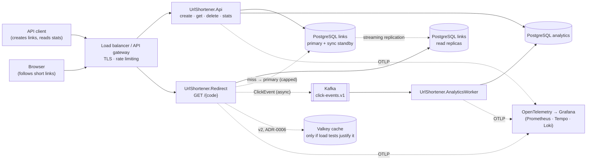
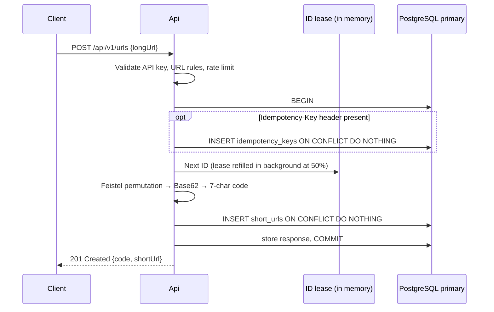
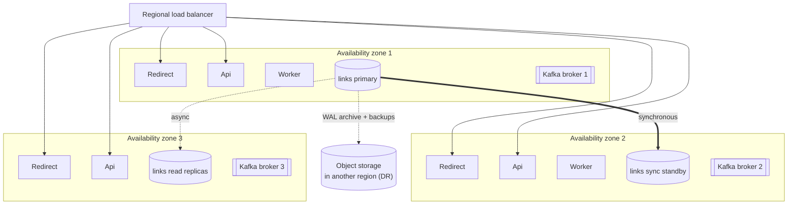
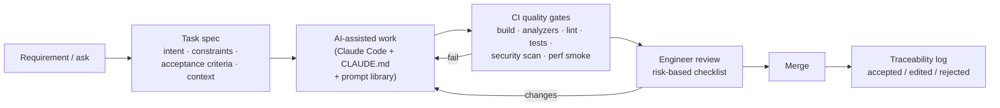

# High-Level Design (HLD)

> Status: draft for engineer review. Decisions are in [`adr/`](adr/README.md); capacity, SLOs and
> detailed design are in the [LLD](02-system-design.md). This document shows how the parts fit together
> and does not repeat the rationale behind each decision.

## 1. System context



## 2. Components

| Component | Responsibility | Scales with | State |
|---|---|---|---|
| **Redirect** | Resolve a code to a URL and return 302/404/410. Publish a click event without blocking. | Read QPS (~35K/s at peak) | Stateless |
| **Api** | Create links (generated code or custom alias), get metadata, delete, return stats. Authenticates API keys and enforces idempotency. | Write QPS (~3.5K/s at peak) | Stateless, apart from an in-memory ID lease |
| **AnalyticsWorker** | Consume click events, aggregate them, write rollups and Kafka offsets in one transaction | Event volume / partitions | Stateless; offsets are stored in the database |
| **PostgreSQL `links`** | System of record. Primary + synchronous standby (different availability zone) + N async read replicas (ADR-0002, ADR-0004) | Reads: add replicas. Storage: Citus when thresholds are reached. | Stateful |
| **PostgreSQL `analytics`** | Hourly rollups and consumer offsets, kept apart from `links` so its writes don't affect replica lag | Rollup write rate | Stateful |
| **Kafka** | Durable click-event log (30-day retention), partitioned by code; supports replay and additional consumers | Click rate | Stateful (log) |
| **Valkey cache** *(conditional)* | Added as a decorator only if the v1 load test fails its criteria (ADR-0006) | Read QPS | Short-lived |
| **Observability stack** | Traces, metrics, logs and SLO dashboards (ADR-0013) | — | — |

The URL Shortener is **one bounded context deployed as three services**, each with its own container
image. They share the `Domain`, `Application` and `Infrastructure` libraries. They also share the `links`
database by design: the Api owns it, and Redirect reads it through the `redirect_lookup` view as a
read-only user. They are not microservices in the database-per-service sense (ADR-0009).

## 3. Key flows

### 3.1 Create a link with a generated code

**Custom alias:** same flow, but the code is the alias. A conflict → **409**.
**Primary failing over:** **503** with `Retry-After`.

### 3.2 Redirect
```mermaid
sequenceDiagram
    participant B as Browser
    participant R as Redirect
    participant RR as Read replica
    participant P as Primary
    participant K as Kafka
    B->>R: GET /{code}
    R->>R: Check code format (rejects junk without a DB read)
    R->>RR: SELECT by code
    alt not found on replica (and fallback budget available)
        R->>P: SELECT by code  [read-your-writes]
    end
    alt still not found
        R-->>B: 404
    else deleted or expired
        R-->>B: 410 Gone
    else active
        R--)K: Produce ClickEvent (non-blocking; GET from non-bots only)
        R-->>B: 302 Location: longUrl (Cache-Control: no-store)
    end
```
Caching headers per status, and handling of `HEAD` and link-preview requests, are defined in ADR-0007.

### 3.3 Delete
`DELETE /api/v1/urls/{code}` → owner check on the primary → `UPDATE … SET deleted_at` → 204. Replicas
receive the change through streaming replication, usually in under 1 s. Replicas lagging more than 2 s
are removed from the read pool, so **99% of deletes take effect within 5 s**.

### 3.4 Analytics
Redirect → `ClickEvent v1` keyed by code → Kafka partition → AnalyticsWorker. The worker aggregates a
batch, then adds the counts to the rollups and stores the next offset **in one transaction**, so each
event is counted exactly once. `GET /stats` reads the rollups, which lag by up to 60 s (SLO).

## 4. Deployment

### 4.1 Production (v1: one region, three availability zones)

- Each tier runs in at least two availability zones. Redirect and read replicas autoscale on CPU and p99.
- `analytics` runs as its own PostgreSQL primary and standby (not drawn).
- The observability stack runs alongside (ADR-0013).
- **A full region outage** is a disaster-recovery event: restore into another region (RTO ≤ 4 h, RPO ≤ 15 min).

### 4.2 Local (prototype)
`docker compose up` starts:
- `postgres:16-alpine` (the `links` and `analytics` databases)
- `apache/kafka` (single node, KRaft)
- `grafana/otel-lgtm`
- the three .NET services (Redirect, Api, AnalyticsWorker)
- a one-off `migrate` step that runs the EF Core migration bundles. The services start only after it succeeds.

Optional profiles add a streaming read replica (for the failover demo) and, if ADR-0006 triggers, Valkey.
Total memory is about 3 GB (A-40).

### 4.3 Later release: multi-region
Each region keeps its own blocks of the ID space (ADR-0005). Custom aliases will also need a single global registry, because each region's primary key only checks its own database. The options are analysed in ADR-0004:
links tied to a home region on PostgreSQL, Cassandra, or distributed SQL.

## 5. Failure modes

| Failure | Behavior | Detection |
|---|---|---|
| `links` primary node or availability zone fails | The synchronous standby is promoted in 30–120 s with no data loss. Writes return 503 + `Retry-After`; **redirects keep working** from replicas. | HA manager events; write error rate |
| A read replica fails | Npgsql's multi-host connection drops it; the other replicas carry the load | Replica health |
| Replica lag > 2 s | The replica is removed from the read pool (protects the delete SLO) | `replica_lag_seconds` |
| Kafka broker fails | Replication factor 3 and producer retries mean no loss | Broker metrics |
| Kafka unavailable | The producer's local queue fills, then events are dropped and counted. **Redirects keep working.** | `clicks_dropped_total` |
| Worker down | Events wait in Kafka. The worker resumes from its stored offset. Stats freshness alert fires. | Consumer lag; freshness |
| `analytics` database down | The worker pauses (offsets aren't advanced); stats return 503; Kafka keeps events for 30 days | Worker errors |
| A lease can't be fetched (primary unreachable) | Creates are failing with 503 anyway, because inserts also need the primary. When the primary is back, background lease refills resume and cold instances stay "not ready" until they have a lease. | Lease-remaining gauge; readiness |
| Region block running out | An alert fires at 80% usage. The operator assigns a reserved block (LLD §6.4 runbook), and instances switch to it automatically when the active block is used up. | `id_block_used_ratio` |
| Hot key (viral link) | The row stays in memory on every replica; load spreads across all of them. Measured by the load test (ADR-0006). | Per-endpoint p99 |
| Scan of non-existent codes | The format check rejects junk; the primary fallback is capped by a token bucket; rate limiting applies | 404 rate; fallback-cap hits |
| Region outage | Full outage; disaster-recovery restore (RTO ≤ 4 h) | External probes |

## 6. Observability (ADR-0013)

| Signal | How it's produced | Where to look |
|---|---|---|
| **Traces** | OpenTelemetry: ASP.NET Core, Npgsql, EF Core, HttpClient. `traceparent` is carried in Kafka headers, and worker spans link to the redirect spans. | Grafana → Tempo |
| **Metrics** | Rate, errors and duration per endpoint, plus: replica lag, delete propagation, consumer lag, dropped clicks, stats freshness, lease remaining, region block usage (`id_block_used_ratio`) | Grafana → Prometheus |
| **Logs** | `ILogger` → OpenTelemetry, JSON with `traceId`/`spanId`. No full URLs, IPs or API keys. | Grafana → Loki |
| **SLOs** | Dashboards and burn-rate alerts kept in the repo as code | Grafana |

Sampling: 100% locally. In production, ~5% based on the parent's decision, plus tail sampling that keeps every error and slow request.

## 7. Other cross-cutting concerns

| Concern | Approach |
|---|---|
| Security | API keys for management endpoints; rate limiting (ASP.NET Core rate limiter); URL validation rules (LLD §7); codes that can't be enumerated in order (random guessing limited by rate limits); no IP collection; secrets kept out of the repo (ADR-0011) |
| Resilience | Polly timeouts and retries with jitter (idempotent calls only), Kafka producer queue as a bounded buffer, graceful shutdown that flushes the producer |
| Configuration | `appsettings.json`, overridden by environment variables; secrets come only from the environment |

## 8. Engineering workflow (how the system is built)



| Workflow component | Location |
|---|---|
| Decisions | `docs/adr/` |
| Assumptions | `docs/assumptions.md` |
| Traceability log | `docs/ai-usage/traceability-log.md` |
| Task specs, prompt library, `CLAUDE.md`, PR template, CI | *To be created in the workflow setup phase* |

## 9. Alternate design (consistency first)

ADR-0002 describes the alternative: send **all reads to the primary** (or to synchronous replicas using
`remote_apply`). Deletes would then take effect instantly. The cost is that the primary must handle about
35K reads/s and redirects would depend on the primary's availability.

Switching only changes connection routing and configuration. Components, flows and the API stay the same.
