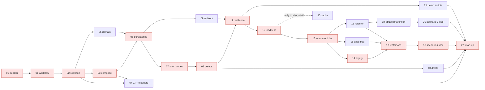

# Task Breakdown

> Status: **Approved** by the engineer on 2026-10-22 (ADR-0012: the engineer approves the breakdown before
> any build task starts). Changes after approval are recorded in the History section at the end. Each task gets a spec `docs/tasks/TSK-xx-*.md`, a branch `task/TSK-xx-*`, one PR and a
> matching `TSK-xx` traceability entry.

## 1. Delivery plan: core first, then extend

| Stage | Scope | Outcome |
|---|---|---|
| **1. Core (option C)** | Publish, workflow, skeleton, CI core gates · **Greenfield:** create (with short-code generation), redirect, alias, delete, resilience, load test · **Brownfield:** expiry (enhancement), alias race (bug fix), validation rules (refactor), test/doc improvement · **Ambiguous:** abuse prevention (rate limits, denylist) · demo and wrap-up | ✅ **Submittable.** All three scenarios complete. Analytics is designed but not built. |
| **2. Lean (option B)** | **Analytics** (Kafka, worker, aggregate table, stats endpoint) as a second brownfield enhancement · extra CI gates (Trivy, ZAP baseline, k6 smoke) | FR-07 partly met (totals and time series only) |
| **3. Full (option A)** | Referrer and device breakdowns (filled in for the last 30 days by replaying Kafka) · SLO dashboards · Stryker · abuse detection on redirect misses | Everything designed |

**Decision points (engineer):**
1. **After TSK-03:** re-estimate using actual hours.
2. **After stage 1:** continue to stage 2, then stage 3, if time allows.

Every stage only **adds** to the previous one. Nothing is redone, because the interfaces (for example
`IClickEventPublisher`) exist from stage 1.

**Two adjustments that make stage 1 complete on its own:**
- **Expiry (FR-04) is the brownfield enhancement**, not part of greenfield. The brief's brownfield scope is "enhancements, refactors, bug fixes", so stage 1 covers all three.
- **No Kafka and no worker until stage 2.** Redirect uses a no-op `IClickEventPublisher`, and the local stack is PostgreSQL plus `grafana/otel-lgtm`.

**While stage 2 isn't built:** FR-07 (analytics) is **not met**. It is recorded as designed (ADR-0008, LLD §6.5) but not implemented, in the requirements and in the final summary.

## 2. Definition of done (every task)

- **Tests are written in the same task as the code**, never as a separate later task:
  - unit tests for new logic,
  - integration tests (Testcontainers) for database and HTTP paths,
  - architecture tests stay green.
- **Test metrics are posted on the PR by CI:** total, passed, failed and skipped per suite, the change in test count against `main`, and coverage per layer.
- **Automatic merge gate** (required status checks, ADR-0012 §5–6):
  - **failed = 0** (100% of executed tests pass),
  - **skipped = 0** (no silently disabled tests),
  - **coverage ≥ 80%** on Domain and Application.

  If any of these fails, GitHub **blocks the merge**. A drop in test count only raises a warning; the engineer decides in review.
- The other required gates are green: build, analyzers, formatting, CodeQL, gitleaks, SCA, **k6 performance smoke** (from TSK-12), and Trivy and ZAP from stage 2.
- Docs, ADRs and assumptions are updated if behavior changed. The PR checklist is completed, and the `TSK-xx` log entry records the **actual hours**.
- **`CHANGELOG.md` has an entry** for every user-visible change (API, behavior, configuration), so changes are traceable (matrix G4).
- **High-risk tasks:** the log entry records the **prompt iterations**: v1 → v2 → … with why each was refined, linking to the versioned prompt in the prompt library (matrix G1).

## 3. Tasks

**Risk:** High / Medium / Low (ADR-0012 §4). Estimates are AI-assisted hours **including engineer review** (§5).

### Stage 1: Core (option C)

#### Publish, workflow and platform
| ID | Task | Depends on | Risk | Est. | Tests | Done when |
|---|---|---|---|---|---|---|
| TSK-00 | Publish the repository to GitHub (public); push `main` | — | High | 0.5 h | — | Repo is public; no PDF, secrets or company references |
| TSK-01 | Engineering workflow: `CLAUDE.md`, task-spec template, **prompt library with version history** (each prompt file keeps a revision log), PR template (ADR-0012 checklist), `CODEOWNERS`, `.gitattributes`, `LICENSE`, **`CHANGELOG.md`** | 00 | Medium | 2 h | — | Files exist; the template contains the checklist |
| TSK-02 | Solution skeleton: solution file, 6 `src` projects and 4 test projects, `Directory.Build.props` (net8.0, C# 11, warnings as errors), `.editorconfig`, health endpoints, OpenTelemetry wiring | 01 | Medium | 2 h | Architecture tests (ADR-0009 rules) | Build and tests pass |
| TSK-03 | Local stack: `docker-compose.yml` (PostgreSQL, `grafana/otel-lgtm`), 3 Dockerfiles, `migrate` step, `.env.example` | 02 | Medium | 1.5 h | Compose smoke check | Everything healthy; traces visible in Grafana. **Re-estimate point 1.** |
| TSK-04 | CI core gates and branch protection: build, analyzers, formatting, unit/architecture/integration tests, **test-metrics report and gate** (failed = 0, skipped = 0, coverage ≥ 80%), CodeQL, gitleaks, SCA | 02, 03 | High | 2.5 h | A deliberately failing test proves the gate blocks merging | Checks required; direct pushes to `main` blocked |

#### Scenario 1: Greenfield
| ID | Task | Depends on | Risk | Est. | Tests | Done when |
|---|---|---|---|---|---|---|
| TSK-05 | Domain model: `ShortUrl`, `ShortCode`, `LongUrl`, `CustomAlias`, `LinkState` | 02 | Medium | 1.5 h | Unit: value rules, alias shape, state | Rules covered |
| TSK-06 | Persistence: `links` migrations (`short_urls`, `id_blocks`, `idempotency_keys`, `redirect_lookup`, database users), repositories, primary and replica data sources | 03, 05 | High | 3 h | Integration: repositories, migrations, view, user permissions | Migration bundle runs in compose |
| TSK-07 | **Short-code generation:** lease from `id_blocks`, Feistel with cycle-walking, Base62, block switch, startup check; benchmark | 06 | High | 3 h | Unit: Base62 round-trip, **property test that codes never collide** · Integration: concurrent leases never overlap | Benchmark recorded |
| TSK-08 | **Create:** `POST /api/v1/urls`, validation rules, API-key auth, generated code or alias (**read-then-insert in v1**), idempotency (LLD §6.1), ProblemDetails, OpenAPI | 07 | High | 3 h | Unit: request hash, validation · API: 201/400/409/422/replay | FR-01, 02, 08, 09, 10 met |
| TSK-09 | **Redirect:** `GET`/`HEAD /{code}`, replica read with a capped primary fallback, caching headers, no-op click publisher | 06 | High | 2 h | Unit: state → status · API: 302/404/410, headers, `HEAD`, create-then-redirect at once | FR-03, NFR-07 met |
| TSK-10 | Metadata and delete: `GET`/`DELETE /api/v1/urls/{code}`, owner checks, soft delete → 410 | 08 | Medium | 1.5 h | API: owner rules, delete then 410 | FR-05, 06 met |
| TSK-11 | Resilience: timeouts, retries, circuit breakers, cancellation (LLD §6.7); idempotency-key cleanup (LLD §6.6) | 08, 09 | High | 3 h | Unit: retry rule (failure before vs during commit) · Integration: **fault injection**, breaker opens and closes, cleanup under the lock | Behavior matches LLD §6.7 |
| TSK-12 | v1 load test (k6, run locally) and the ADR-0006 cache decision; **k6 smoke job in CI** (starts the compose stack, fails if p99 exceeds the SLOs) | 04, 09, 11 | Medium | 3 h | k6 against the pass/fail criteria; CI smoke proven to fail on a seeded slow endpoint | Results recorded in ADR-0006; performance gate required in branch protection |
| TSK-13 | Scenario 1 write-up | 12 | Low | 1 h | — | Ask → normalization → decomposition → execution → validation → outcome |

#### Scenario 2: Brownfield (on the merged scenario-1 code)
| ID | Task | Depends on | Risk | Est. | Tests | Done when |
|---|---|---|---|---|---|---|
| TSK-14 | **Enhancement: link expiry** (FR-04): `expiresAt` on create, 410 after expiry, expand-only migration | 13 | High | 1 h | Unit: expiry rules · API: expired → 410 | FR-04 met; impact analysis written |
| TSK-15 | **Bug fix: alias race** (500 instead of 409). The concurrency test is committed first and **fails**, then `ON CONFLICT` fixes it | 13 | High | 1.5 h | Integration: concurrent same-alias requests | The failing test is visible in the PR before the fix |
| TSK-16 | **Refactor:** URL validation into separate `IUrlValidationRule` classes, with characterization tests first | 13 | Low | 1 h | Same tests pass before and after | Behavior unchanged |
| TSK-17 | **Test and documentation improvement:** fill coverage gaps; complete the OpenAPI descriptions | 14–16 | Low | 1 h | Coverage report | Gaps closed; docs complete |
| TSK-18 | Scenario 2 write-up, with an impact analysis per change | 14–17 | Low | 1 h | — | Evidence links |

#### Scenario 3: Ambiguous
| ID | Task | Depends on | Risk | Est. | Tests | Done when |
|---|---|---|---|---|---|---|
| TSK-19 | *"Make it secure so people can't abuse it"*: clarifying questions → assumptions → measurable requirements; rate limits on create and redirect; threat-check interface with a local denylist | 16 | High | 2 h | Unit: denylist, limit rules · API: 429, blocked URL → 400 | Requirements recorded; tests pass |
| TSK-20 | Scenario 3 write-up | 19 | Low | 1 h | — | The vague-to-measurable transformation is visible |

#### Wrap-up
| ID | Task | Depends on | Risk | Est. | Tests | Done when |
|---|---|---|---|---|---|---|
| TSK-21 | Demo scripts: `demo.ps1`/`demo.sh` (create → redirect → delete → 410); stop and restart the primary (circuit-breaker demo) | 11 | Medium | 1 h | Scripts run on a clean machine | — |
| TSK-22 | Wrap-up: `05-testing-strategy`, `06-risks-tradeoffs`, `08-final-summary`, README setup and reviewer tour, clean-clone run, final confidentiality check | all | Medium | 3 h | Clean-clone run | A fresh clone runs end to end following the README. **Decision point 2.** |

### Stage 2: Lean (option B)
| ID | Task | Depends on | Risk | Est. | Tests | Done when |
|---|---|---|---|---|---|---|
| TSK-23 | **Enhancement: analytics.** Kafka in compose, `ClickEvent v1`, Kafka producer in Redirect, AnalyticsWorker, `analytics` migrations (one aggregate table), stats endpoint (totals and time series) | 22 | High | 4 h | Integration: **each event counted exactly once with replayed events**, freshness ≤ 60 s | FR-07 partly met; brownfield write-up extended |
| TSK-24 | CI extra gates: Trivy, ZAP baseline, k6 smoke; daily and nightly schedules | 04, 23 | High | 1.5 h | Gates proven to fail on a seeded issue | Required checks updated |
| TSK-25 | Demo and docs updated for analytics | 23 | Low | 0.5 h | Demo script | — |

### Stage 3: Full (option A)
| ID | Task | Depends on | Risk | Est. | Tests | Done when |
|---|---|---|---|---|---|---|
| TSK-26 | Analytics breakdowns (referrer, device), backfilled by replaying Kafka | 23 | High | 2 h | Integration: replay backfill | FR-07 fully met |
| TSK-27 | SLO dashboards and burn-rate alerts as code | 23 | Medium | 2 h | Dashboards provisioned | — |
| TSK-28 | Stryker mutation testing | 17 | Low | 1 h | Mutation score reported | — |
| TSK-29 | Scenario 3 extension: abuse detection on redirect misses; separate write-ups | 19, 23 | Medium | 2 h | API: scanning a client gets throttled | — |

### Conditional (any stage)
| ID | Task | Trigger | Risk | Est. |
|---|---|---|---|---|
| TSK-30 | Cache decorator with Valkey, with before/after numbers in ADR-0006 | TSK-12 fails its pass/fail criteria | High | 3 h |

## 4. Dependencies and critical path (stage 1)

**Critical path:** 00 → 01 → 02 → 03 → 06 → 07 → 08 → 11 → 12 → 13 → 14 → 17 → 18 → 22, about **28 h**.
Off the critical path: 04, 05, 09, 10, 15, 16, 19–21.

## 5. Effort, and how the estimates were made

| Stage | Tasks | Estimate | Cumulative |
|---|---|---|---|
| **1. Core (C)** | TSK-00 to 22 | **~41.5 h** | ~41.5 h |
| 2. Lean (B) | TSK-23 to 25 | ~6 h | ~47.5 h |
| 3. Full (A) | TSK-26 to 29 | ~7 h | ~54.5 h |
| Conditional | TSK-30 | ~3 h | — |

**How the estimates were made:** this is engineering judgment, not measurement. Each estimate covers the **whole loop**,
of which AI code generation is the smallest part. For a typical 3 h task:

| Step | Who | Time |
|---|---|---|
| Write the task spec | AI drafts, engineer approves | 10–15 min |
| Generate code and tests | AI | 15–30 min |
| Build, run and debug (tests, Testcontainers, Docker) | AI and engineer | 45–60 min |
| Engineer review and questions | Engineer | 45–60 min |
| CI round-trips and fixes | Both | 20–30 min |
| PR checklist, AI disclosure, log entry, merge | AI drafts, engineer completes | 15–20 min |

Across stage 1, that's roughly 7–8 h of AI generation, ~10 h of debugging, ~12 h of review, ~5 h of CI and ~5 h of documentation and process work.
Treat every figure as **±30–50%**. Actual hours are recorded in each `TSK-xx` log entry, and the plan is re-estimated at decision point 1.
**Lighter review on Low-risk tasks**, while High-risk tasks keep a full review, would bring stage 1 to roughly **33–36 h**.

### 5.1 Re-estimate point 1 (after TSK-03), accepted by the engineer on 2026-10-22
| Task | Estimate | Actual |
|---|---|---|
| TSK-00 | 0.5 h | 0.5 h |
| TSK-01 | 2 h | 0.5 h |
| TSK-02 | 2 h | 0.37 h |
| TSK-03 | 1.5 h | 0.17 h |
| **Total** | **6 h** | **1.5 h (ratio 0.26)** |

The first tasks were scaffolding and infrastructure, where AI generation is strongest. The remaining tasks
carry business rules, concurrency and resilience, so the ratio applied is **cautious and set per risk
class**, rather than the observed 0.26:

| Remaining stage-1 tasks | Original | Ratio | New |
|---|---|---|---|
| High risk (TSK-04, 06, 07, 08, 09, 11, 14, 15, 19) | 21 h | 0.45 | ~9.5 h |
| Medium (TSK-05, 10, 12, 21, 22) | 10 h | 0.35 | ~3.5 h |
| Low (TSK-13, 16, 17, 18, 20) | 5 h | 0.30 | ~1.5 h |

| Stage | Original | Re-estimated |
|---|---|---|
| 1. Core, including the 1.5 h already done | ~41.5 h | **~16 h** |
| 2. Lean | +6 h | +~2.5 h |
| 3. Full | +7 h | +~3 h |
| **All stages** | ~54.5 h | **~21.5 h** |

**Decision:** the order stays the same (stage 1, then decision point 2), but **stages 2 and 3 are now planned**
rather than optional. Decision point 2 re-checks this with about 20 measured tasks.

**Timebox:** the brief allows 2–3 days, and the design phase used about 2 of them. Even stage 1 goes beyond the timebox. The final summary
says so openly: the in-depth design phase was a deliberate choice, recorded in this repository.

## History
- 2026-10-22 · Draft · 31 tasks in 3 stages; definition of done with a test-metrics gate; estimates corrected (C ~40 h, B ~46 h, A ~53 h).
- 2026-10-22 · **Approved** · Engineer approved stage 1 (core) as the starting plan.
- 2026-10-22 · **Amended and approved** · Gaps found by the traceability matrix (requirements §6.8), approved by the engineer: prompt library with version history, and prompt iterations logged for high-risk tasks (G1); k6 performance smoke in stage-1 CI via TSK-12 (G2); `CHANGELOG.md` and a CHANGELOG entry in the definition of done (G4). Stage 1 is now ~41.5 h.
- 2026-10-22 · Changed at TSK-03 spec approval · The `migrate` step moves from TSK-03 to **TSK-06**: there are no migrations until the schema exists. Approved by the engineer.
- 2026-10-22 · **Re-estimate point 1 accepted** · Stage 1 ~16 h, all stages ~21.5 h; stages 2 and 3 planned (§5.1).
