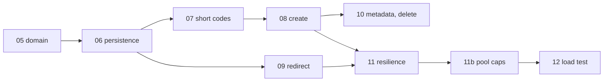

# Scenario 1: Greenfield (TSK-05 to TSK-12)

Building the core URL shortener from an empty solution skeleton: shorten, custom alias, redirect, metadata and
delete, idempotent retries, resilience, and a load test. Expiry moved to the brownfield scenario (TSK-14), and
analytics to stage 2 (TSK-23); see the [task breakdown](../04-task-breakdown.md).

Every claim below links to its evidence: a task spec, a PR, a row of the
[traceability log](../ai-usage/traceability-log.md), a test, or a results file.

## 1. The ask

In our own words: a URL-shortening service with core APIs, built for 100M new links a day with 10× as many
redirects, low latency, and reliability under failure, where the engineer leads and AI assists.

## 2. Normalization

The ask became measurable requirements and recorded decisions before any code:

| From | To | Where |
|---|---|---|
| "Shorten URLs" | FR-01 shorten, FR-02 alias (409 / 400), FR-03 redirect (302 / 404 / 410), FR-05 delete, FR-06 metadata, FR-08 safe retries, FR-09 API keys and ownership, FR-10 URL validation | [requirements §2](../01-requirements.md) |
| "Scalable, low latency" | ~3.5K creates/s and ~35K redirects/s at peak; redirect p99 ≤ 50 ms, create p99 ≤ 200 ms | [requirements §3](../01-requirements.md), [LLD §1–2](../02-system-design.md) |
| "Reliable" | Availability for reads, consistency for writes; synchronous standby; timeouts, retries, breakers | [ADR-0002](../adr/0002-consistency-and-availability-model.md), [LLD §6.7](../02-system-design.md) |
| Questions we couldn't ask | 33 assumptions, each with a risk and a fallback | [assumptions](../assumptions.md) |
| Design choices | 13 ADRs, each with alternatives, accepted by the engineer in signed commits | [ADR index](../adr/README.md) |

## 3. Decomposition

Eight build tasks, each with a spec the engineer approved before work started, a branch, one PR, tests in the
same task, and a log entry ([plan](../04-task-breakdown.md) §3–4):

Specs: [TSK-05](../tasks/TSK-05-domain-model.md) · [06](../tasks/TSK-06-persistence.md) ·
[07](../tasks/TSK-07-short-codes.md) · [08](../tasks/TSK-08-create-endpoint.md) ·
[09](../tasks/TSK-09-redirect.md) · [10](../tasks/TSK-10-metadata-delete.md) ·
[11](../tasks/TSK-11-resilience.md) · [12](../tasks/TSK-12-load-test.md). TSK-11b wasn't planned: the load
test found the bug it fixes.

## 4. AI-assisted execution

**The split of work.** Claude Code (Claude Opus 5.5) wrote the code, tests and documentation from each approved
spec, using the versioned [prompt library](../ai-usage/prompts/README.md). The engineer:
- approved every spec and its decisions;
- reviewed every PR, with the ownership statement on high-risk ones;
- made the merge commit, which is the sign-off in this one-person repository ([ADR-0012](../adr/0012-engineer-led-workflow-and-sign-off.md)).

**Decisions the engineer made** (from the specs and the log):

| Task | Decision |
|---|---|
| TSK-07 | No property-testing library (seeded loops); the Feistel key is a passphrase of at least 32 characters, hashed with SHA-256; the usage alert waits for the dashboards (TSK-22) |
| TSK-08 | **D2**: after asking for an explanation, chose to implement the alias insert correctly instead of planting the "read-then-insert" race the plan had reserved for TSK-15; TSK-15 will fix a real defect ([PR #13](https://github.com/rajeshj18/url-shortener-dotnet/pull/13)) |
| TSK-08 | API keys as hashes in configuration; Swagger UI behind a flag; `expiresAt` rejected until expiry exists |
| TSK-09 to 13 | Approved all five specs in one batch, and asked for a faster workflow. The AI declined to approve or merge its own work, because that would remove the engineer's sign-off. Instead it proposed batch spec approval, starting the next task at once, and GitHub auto-merge, so the engineer still makes the merge ([PR #14](https://github.com/rajeshj18/url-shortener-dotnet/pull/14)) |

**What the AI got wrong, and how it was caught.** The process caught more AI mistakes than any single review
would have. All of these are in the log:

| Caught by | Mistake | Task |
|---|---|---|
| Analyzers (warnings as errors, `AnalysisMode=All`) | Connection pools registered by instance and never disposed (CA2000); SQL passed through a variable (CA2100) | TSK-06, 07 |
| Docker on an arm64 host | Migration bundle hard-coded to x64 | TSK-06 |
| AI self-review | A failed background pre-fetch surfaced as an error to a caller | TSK-07 |
| gitleaks, locally before push | A test constant and a README example that looked like secrets (false positives, fixed before push) | TSK-07, 08 |
| API tests | `application/json` instead of `problem+json` on errors; a valid create returning `500` (EF's limit on internal providers, test-harness only) | TSK-08 |
| **A test that tested nothing** | The "API keys are never logged" test passed because no logs were captured at all | TSK-08 |
| **CI on Linux** | The OpenAPI snapshot, generated on Windows, held CRLF inside descriptions | TSK-08b |
| AI re-reading its tests | An unawaited async assertion; then the same mistake again a task later (`.Wait()`) | TSK-09, 10 |
| **An existing test from an earlier task** | The new request-timeout response was written with the cancelled token, so clients got `500` | TSK-11 |
| **The load test** | Connection pools never capped (an LLD requirement missed in TSK-06 and TSK-11): PostgreSQL ran out of connections at 1,500 redirects/s. The AI's first hypothesis was wrong | TSK-11b |
| The load test | Cold start breaking a short CI run; fixed with a warm-up, thresholds unchanged | TSK-12 |

**Prompt iterations** for every high-risk task (TSK-06, 07, 08, 09, 11, 11b) are recorded in their log rows: for
example, TSK-11 went v1 (spec) → v2 (package research) → v3 (analyzer findings) → v4 (`debug.md` on a failing
test) → v5 (tests) → v6 (mutation check).

## 5. Validation

| Gate | Evidence |
|---|---|
| Tests in the same task, CI-gated (failed = 0, skipped = 0, coverage ≥ 80% on Domain and Application) | 405 tests at TSK-12: 294 unit, 19 architecture, 92 integration on real PostgreSQL (Testcontainers); unit-test line coverage Domain 100%, Application 97.4% |
| **Property tests** | No duplicate codes across 1M IDs; Feistel round-trip over 100k IDs (TSK-07) |
| **Concurrency** | Concurrent leases never overlap; 12 simultaneous requests for one alias → one `201`, eleven `409`; 10 identical requests with one key → one link (TSK-07, 08) |
| **Fault injection** | A frozen PostgreSQL container → fast `503`, recovery without a restart; a dead primary → the breaker opens and redirects keep serving from the replica (TSK-11) |
| **Mutation checks** | Each high-risk task applied deliberate bugs and showed the tests fail: 3/3 caught in TSK-07, 08, 09 and 11; the owner check in TSK-10 |
| Security | CodeQL, gitleaks, dependency audit on every PR; least-privilege database roles tested as denials (TSK-06) |
| Benchmark | ~2.1 µs per short code (TSK-07) |
| **Load test** | Redirect p99 3.8 ms at 1,500/s per instance, create p99 7.1 ms at 600/s, 0% errors; a k6 smoke on every PR ([results](../perf/v1-load-test.md)) |

## 6. Outcome

| Requirement | Status |
|---|---|
| FR-01, 02, 03, 05, 06, 08, 09, 10 | ✅ met (TSK-08 to TSK-10) |
| FR-04 expiry | ⏳ brownfield enhancement, TSK-14 |
| FR-07 analytics | ⏳ stage 2, TSK-23 (click events are already built and counted; the publisher is a no-op until Kafka) |
| NFR-02 latency | ✅ well inside the SLOs at the tested rate; production sizing extrapolated |
| Cache | Not needed for v1 ([ADR-0006 results](../adr/0006-caching-measure-first.md)) |

**Estimate versus actual** (actual = engineer time reported when opening each PR; the AI's own working time
isn't measured):

| Task | Estimate | Actual | PR |
|---|---|---|---|
| TSK-05 Domain model | 1.5 h | 0.17 h | [#10](https://github.com/rajeshj18/url-shortener-dotnet/pull/10) |
| TSK-06 Persistence | 3 h | 0.5 h | [#11](https://github.com/rajeshj18/url-shortener-dotnet/pull/11) |
| TSK-07 Short codes | 3 h | 0.5 h | [#12](https://github.com/rajeshj18/url-shortener-dotnet/pull/12) |
| TSK-08 Create | 3 h | 1 h | [#13](https://github.com/rajeshj18/url-shortener-dotnet/pull/13) |
| TSK-09 Redirect | 2 h | 0.17 h | [#15](https://github.com/rajeshj18/url-shortener-dotnet/pull/15) |
| TSK-10 Metadata and delete | 1.5 h | 0.17 h | [#16](https://github.com/rajeshj18/url-shortener-dotnet/pull/16) |
| TSK-11 Resilience | 3 h | 0.17 h | [#17](https://github.com/rajeshj18/url-shortener-dotnet/pull/17) |
| TSK-11b Pool caps (unplanned) | — | 0.33 h | [#18](https://github.com/rajeshj18/url-shortener-dotnet/pull/18) |
| TSK-12 Load test | 3 h | 0.58 h | [#19](https://github.com/rajeshj18/url-shortener-dotnet/pull/19) |
| **Total** | **20 h** | **≈ 3.6 h** | |

**Lessons:**
1. **The gates found what review alone would have missed**: a vacuous test, a Linux-only failure, a cancelled-token
   bug, and a missed LLD requirement that only appeared under sustained load.
2. **Planned bugs aren't needed.** TSK-15's original bug couldn't occur in correct code; real defects arrived on
   their own (TSK-08b, TSK-11b).
3. **Short reviews worked because the evidence came with each PR**: mutation checks, fault injection and load
   numbers. They are not a reason to skip review.
4. **Measure before optimizing**: the load test settled the cache question with data, and showed the real limit
   is application CPU and, at scale, connection count.
